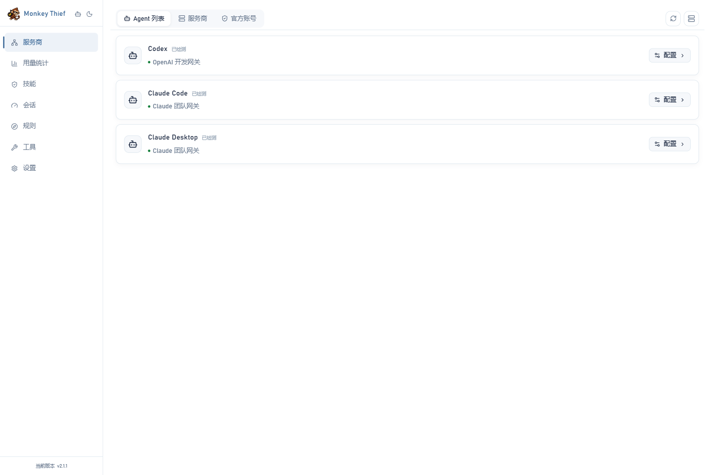
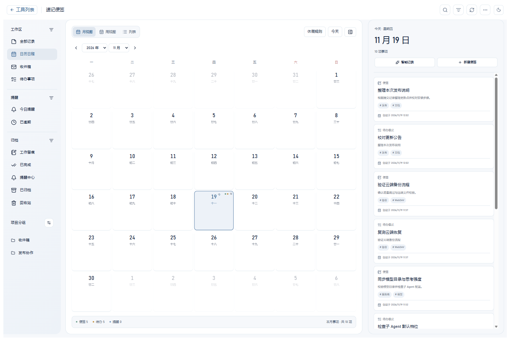
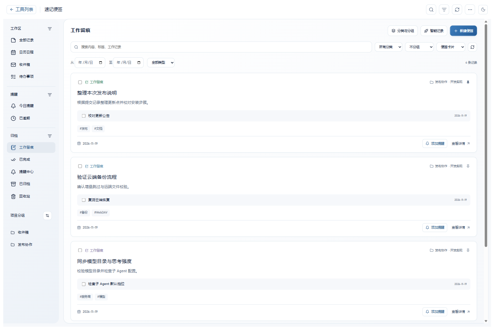
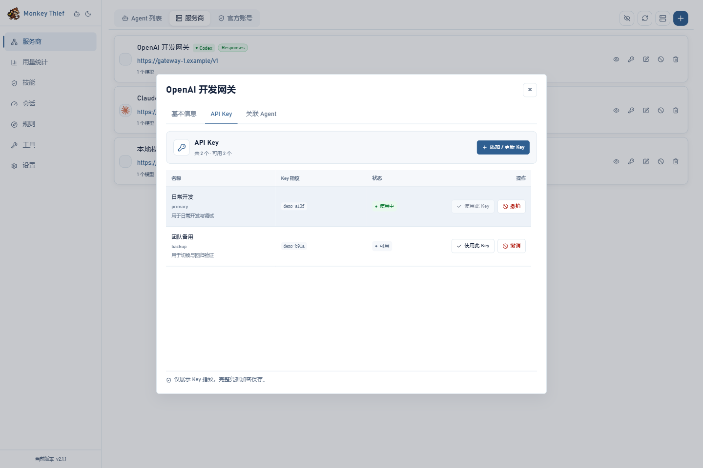
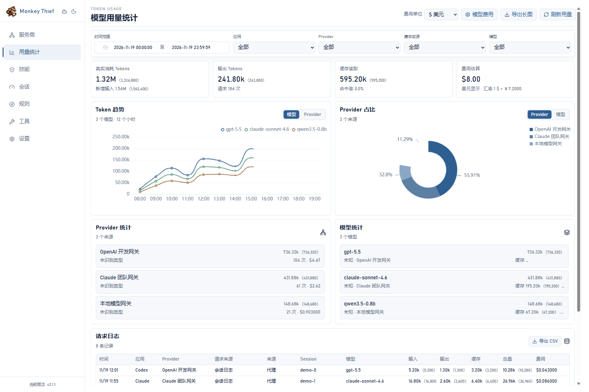
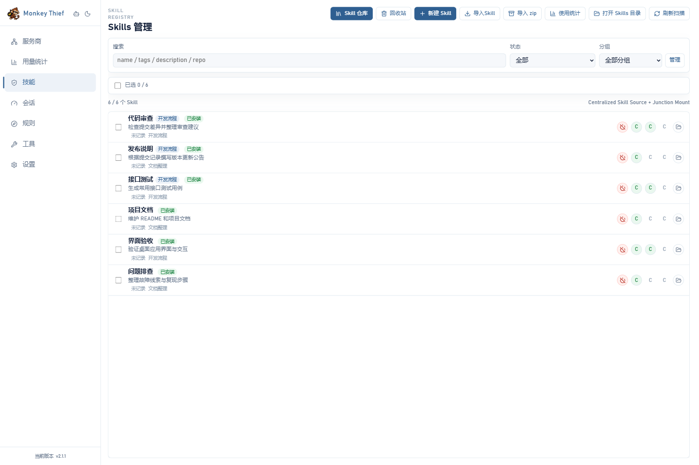
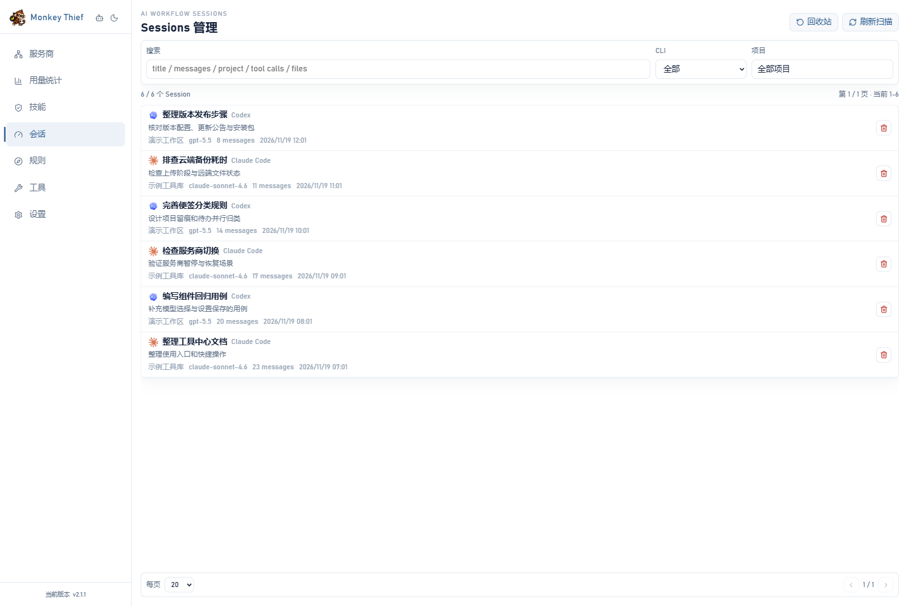
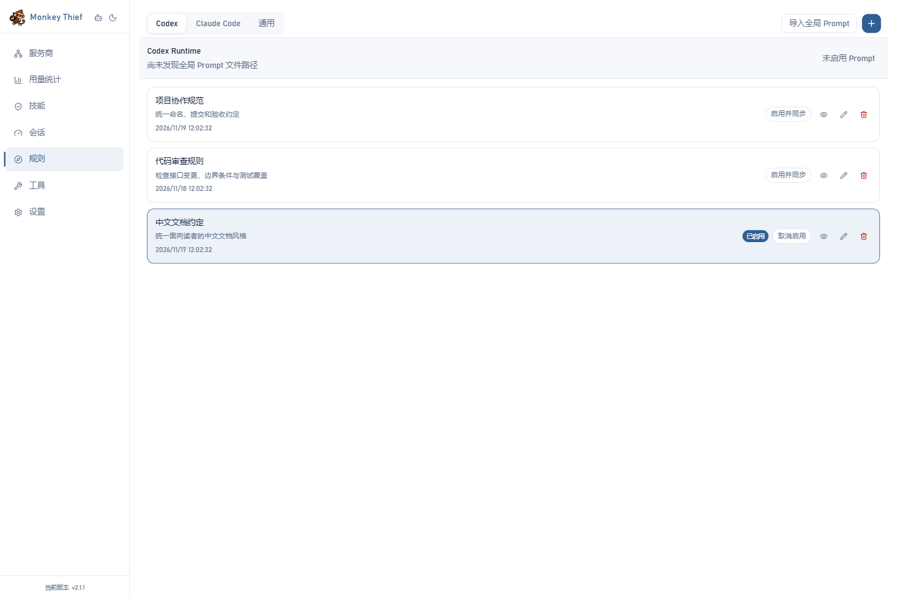
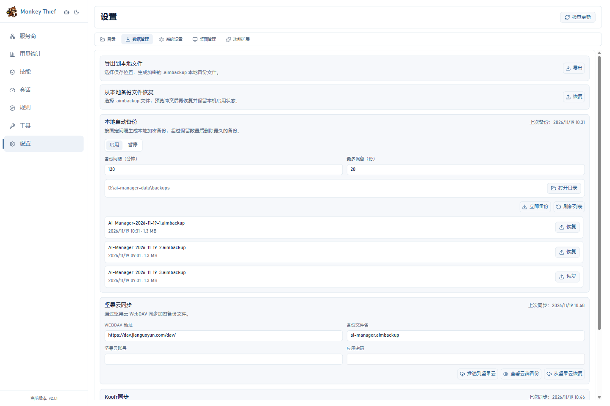

<div align="center">
  
  <h1>Monkey Thief</h1>
  <p>在 Windows 上统一管理 Codex、Claude Code 和 Claude Desktop 的服务商、模型与开发配置。</p>
  <p>
    <a href="https://github.com/hxysj/AI-Manager/releases/latest">
      
    </a>
    
  </p>
  <p>
    <a href="https://github.com/hxysj/AI-Manager/releases/latest">下载 Windows 安装包</a>
    · <a href="#快速开始">快速开始</a>
    · <a href="#从源码运行">从源码运行</a>
  </p>
</div>

Monkey Thief 集中管理分散在各个客户端的服务商、API Key、官方账号、技能、规则、会话和用量。桌面应用还提供应用助手、速记便签、截图贴图、离线 OCR 与翻译，以及加密备份。

## 安装

在 Windows 10 或 Windows 11（x64）上使用。运行需要 WebView2 Runtime。启用应用助手时需要 Node.js 22.13 或更高版本。

1. 打开发布页，下载 `Monkey-Thief-windows-setup.exe` 并运行安装程序。[GitHub Releases](https://github.com/hxysj/AI-Manager/releases/latest)
2. 安装需要管理的客户端。首次启动 Monkey Thief 后，在「设置 → 目录」确认数据目录和客户端配置目录。默认数据目录为 `D:\ai-manager-data`，修改后重启生效。

已安装的用户可在「设置」中点击「检查更新」。

## 快速开始

### 给客户端配置服务商

1. 在「设置 → 系统设置」启用「共享服务商模式」，然后打开侧栏「服务商」。
2. 添加 API 服务商并填写请求地址、协议、模型和 API Key，或在对应的官方账号页完成授权。Codex 官方账号支持 OAuth 登录以及导入 `auth.json`。Google 账号可通过本机网关把 Gemini 模型接入 Codex。
3. 为 Codex、Claude Code 或 Claude Desktop 选择要使用的服务商和默认模型。模型目录有能力信息时，可查看支持的思考强度。子 Agent 可以配置默认模型和思考强度。
4. 在客户端发起一次请求，并在「用量统计」查看记录。需要解除某个客户端的接管时，选择「停止使用，恢复原有配置」。

同一 API 服务商可保存多个带备注的 API Key，并选择当前生效项。关闭共享服务商模式会暂停接管，重新开启时会尝试恢复各 Agent 上次选用的服务商和模型。使用本机网关转发时，请保持 Monkey Thief 运行。

### 使用助手与速记

- 在「设置 → 功能扩展 → 应用助手」选择服务商、官方账号或已安装的助手模型。通过侧栏顶部的助手图标打开会话，或按 `Ctrl+Alt+Space` 唤出桌面输入框。助手支持流式回复、会话历史、上下文压缩、公共记忆和独立的技能与工具管理。
- 在「工具 → 速记便签」直接记录，或在应用助手、桌面输入框中打开「速记」。AI 可整理原文、拆分事项、按项目归类，并提取待办与提醒。
- 已提出但尚未实施的项目需求也可以进入「工作留痕」，同时保留待办。公历与农历日历可查看便签、截止日期和提醒，并支持配置排班规则。[速记便签功能设计](docs/速记便签功能结构设计.md)

## 功能一览

| 模块 | 能力 |
| --- | --- |
| 服务商与账号 | 集中维护 API 服务商、模型目录、模型映射、API Key 和官方账号。服务商模式支持按客户端配置模型，旧模式保留直连和 Proxy 接管入口。 |
| 用量统计 | 按应用、服务商和模型查看 Token、缓存、费用与请求记录。网关请求支持按 API Key 查看成功、失败和用量。 |
| 技能、会话与规则 | 管理 Skills 仓库、分组和安装状态，检索 Codex 与 Claude Code 的本机会话，并按客户端启用全局规则。 |
| 应用助手 | 支持独立窗口、桌面快捷输入和桌宠回复。助手可以使用配置的远程模型，也可使用已下载的 Qwen3.5-0.8B。 |
| 速记便签与日历 | 支持手动记录、AI 整理、待办、工作留痕、工作小结、Markdown / JSON 导出，以及单次、重复和提前提醒。 |
| 截图贴图 | 区域截图、长截图、标注、置顶贴图、截图历史和 OCR。快捷键可在「设置 → 功能扩展 → 截图贴图」修改。 |
| 本地大模型 | 下载、校验和管理本地模型。可用 MiniCPM-OCR 识别图片，用 LMT-60 或 Qwen3.5 进行离线翻译。 |
| 图片工作台 | 使用 Codex 官方账号，通过 Web 或 Codex 通道生成与编辑图片，支持参考图、批量任务、历史及提示词库。 |
| 设备快传 | 在可信局域网内发现并连接其他客户端，也可通过链接或二维码邀请浏览器访客，支持文字、图片和文件传输。 |
| 开发工具 | 提供多协议反代、JSON 智能解析、文本与 JSON 差异对比、Git 管理、端口监测、网络质量监测和 Codex 宠物管理。 |

## 数据与备份

在「设置 → 数据管理」可导出和恢复加密的 `.aimbackup` 文件，配置定时本地备份，或使用坚果云、Koofr 的 WebDAV 上传和恢复。恢复前可预览差异，并为冲突记录选择保留本机或采用备份版本。

| 数据 | 备份范围 |
| --- | --- |
| 业务数据 | 服务商配置、模型与 Key、技能、规则、模型费用表、Codex 宠物，以及速记便签、待办、修订、提醒计划和排班规则。 |
| 本机记录 | 用量明细、客户端会话、请求日志和提醒投递记录保留在本机。 |
| WebDAV 上传 | 技能资源会过滤依赖、缓存和已知运行产物。云端备份会压缩并加密，上传完成后再替换远端备份。备份内容未变且远端文件验证通过时，跳过重复上传。WebDAV 连接设置随本地备份保存。 |

使用远程模型执行任务时，任务所需的文本或图片会发送给选定的服务。OCR 和翻译可在安装对应本地模型后离线运行。

## 界面截图

以下为 `v2.1.1` 的界面截图，使用演示数据。



<details>
<summary>速记便签、工作留痕与日历</summary>





</details>

<details>
<summary>服务商与 API Key、用量统计</summary>





</details>

<details>
<summary>技能、会话与规则管理</summary>







</details>

<details>
<summary>本地备份与 WebDAV</summary>



</details>

## 从源码运行

开发环境需要 Node.js 22.13 或更高版本、Rust stable 工具链、带 Windows SDK 的 Microsoft C++ Build Tools，以及 WebView2 Runtime。

```powershell
git clone https://github.com/hxysj/AI-Manager.git
cd AI-Manager
npm ci
npm run dev
```

开发服务优先使用 `http://127.0.0.1:13134`，端口被占用时顺延。`npm run dev:renderer` 可单独预览 Vue 界面，文件、数据库和客户端配置操作需要通过 `npm run dev` 启动 Tauri。

### 打包 Windows 安装程序

项目启用了自动更新签名。打包时需提供与更新公钥对应的 `TAURI_SIGNING_PRIVATE_KEY`，私钥有密码时同时提供 `TAURI_SIGNING_PRIVATE_KEY_PASSWORD`。

```powershell
npm run dist:win
```

Windows NSIS 安装包输出到 `src-tauri/target/release/bundle/nsis/`。

### 代码结构

桌面端使用 Tauri 2、Rust、Vue 3、Vite 和 Element Plus。Vue 通过 Tauri IPC 调用本机业务接口，Rust 使用 SQLite 保存业务数据，并负责客户端配置、网关和 WebDAV。应用助手使用 Mastra 和 libSQL。

| 路径 | 用途 |
| --- | --- |
| `src/features/` | 服务商、应用助手、速记便签、设置等界面模块。 |
| `src-tauri/src/api/` | 本机业务接口和 Tauri 请求处理。 |
| `src-tauri/src/core/` | 配置、路径、SQLite 和应用状态。 |
| `src-tauri/node/` | 应用助手及翻译辅助服务。 |
| `scripts/` | 启动、构建、版本同步与回归脚本。 |

### 版本与发布说明

在 `package.json` 中维护应用版本，运行 `npm run sync:version` 同步 npm 锁文件、Cargo 版本和发布说明标题。运行 `npm run sync:version -- --check` 可检查版本一致性，发布说明正文按当次变更更新。[发布说明](build/release-notes.md)

遇到使用问题时，提交 Issue 并注明应用版本、Windows 版本和复现步骤。分享日志前请移除 API Key、登录凭据和应用密码。[GitHub Issues](https://github.com/hxysj/AI-Manager/issues)
