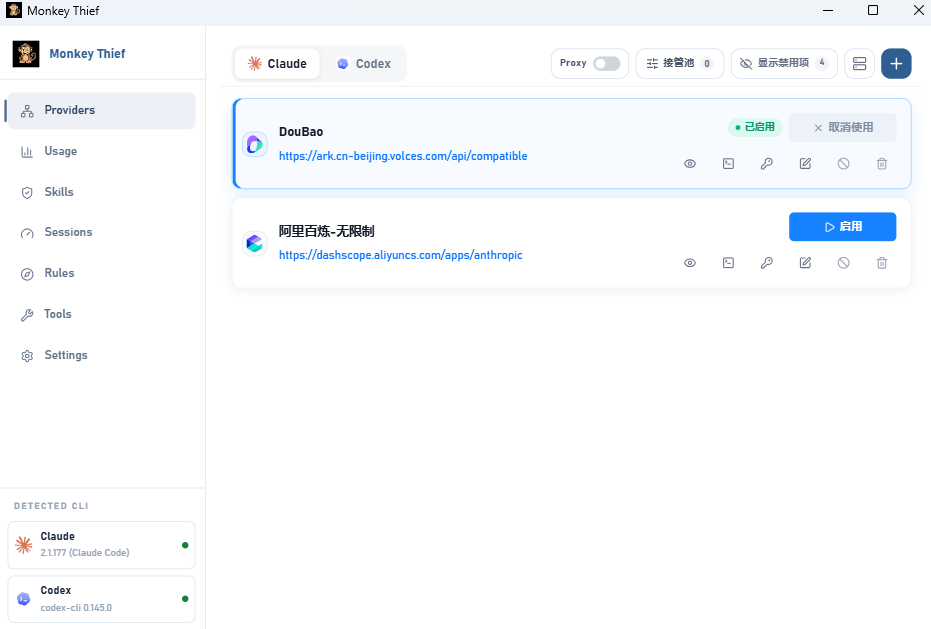
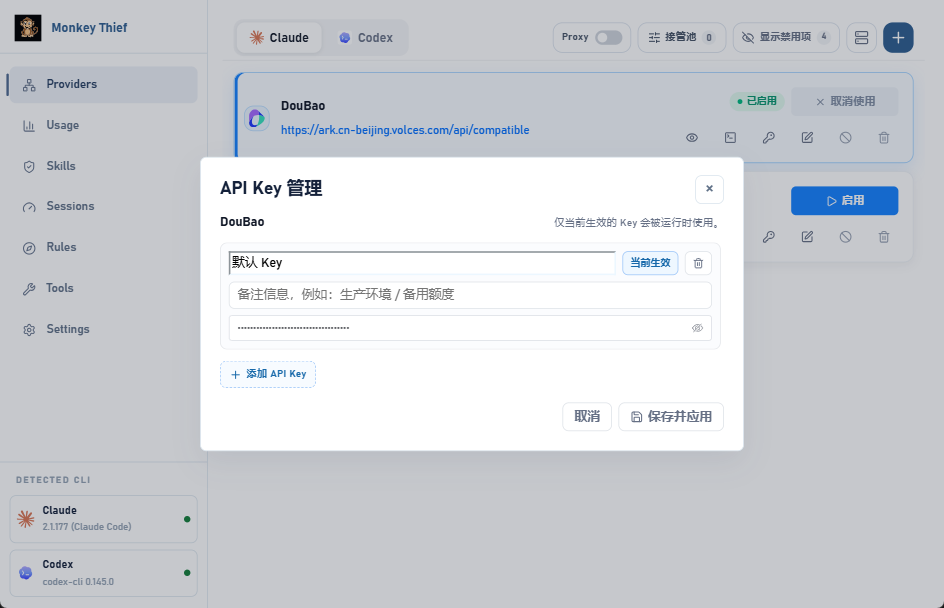
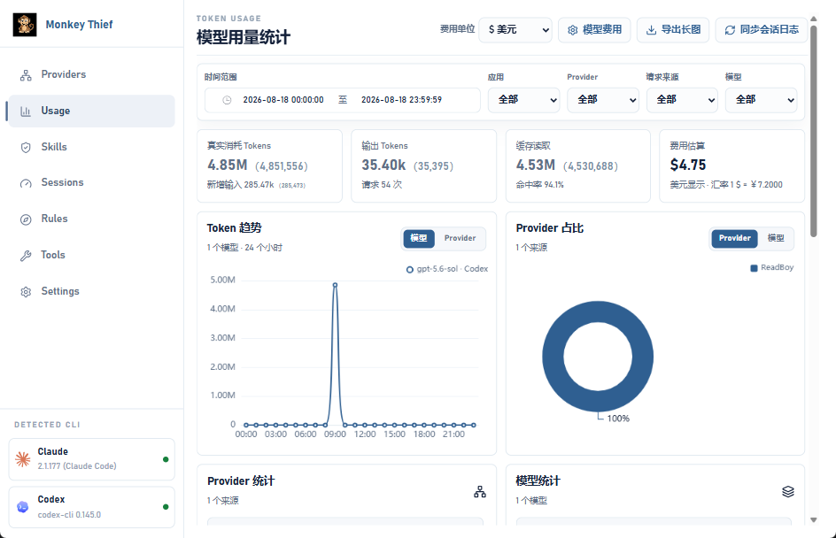
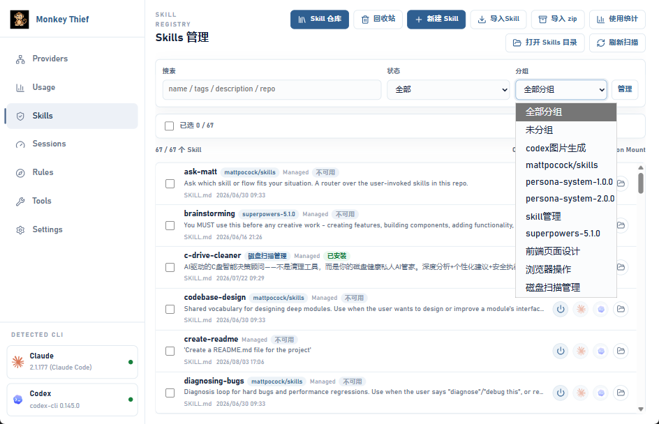
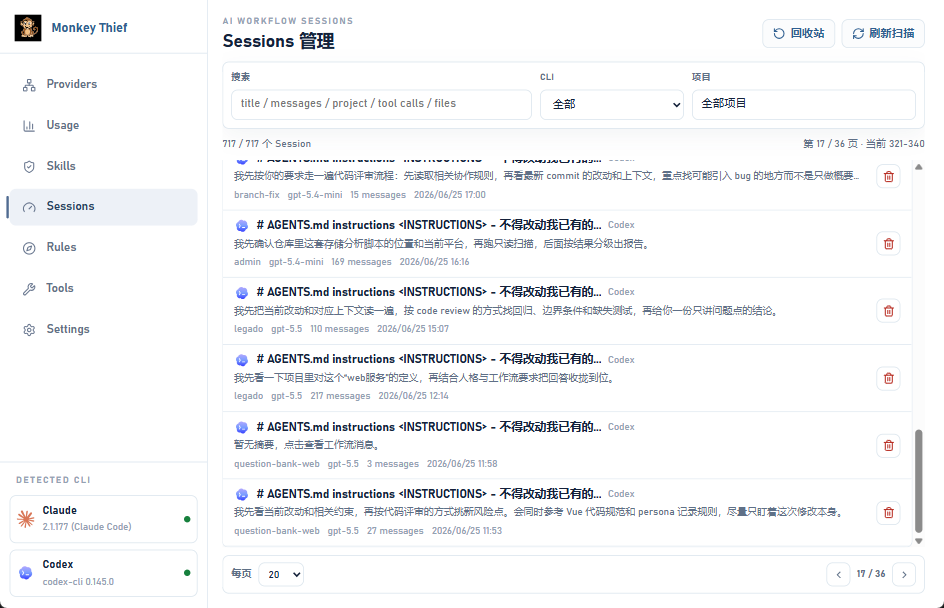
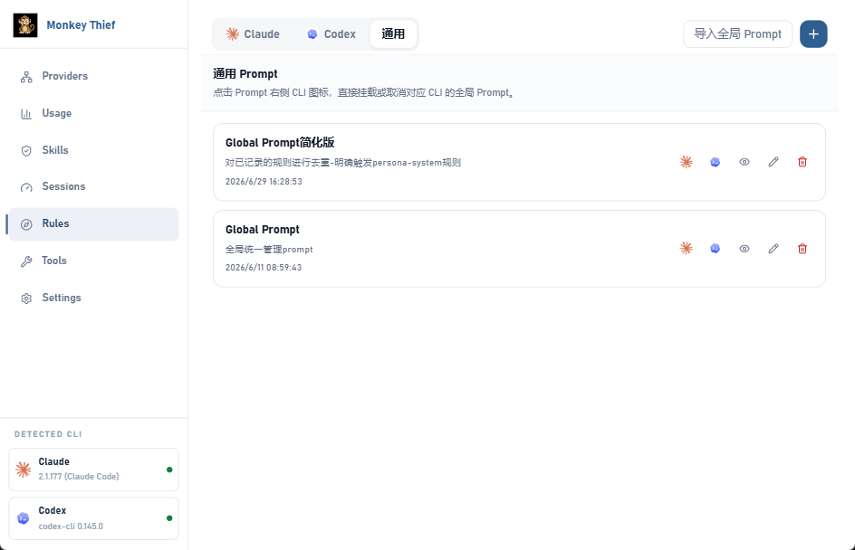
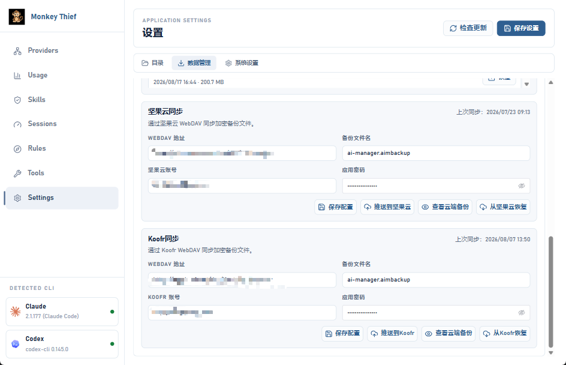
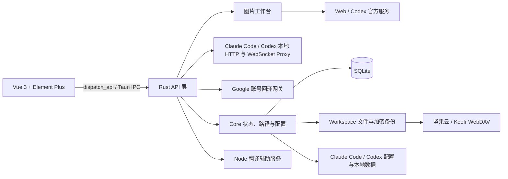

<div align="center">
  
  <h1>Monkey Thief</h1>
  <p>面向 Claude Code 与 Codex 的本地优先桌面管理与创作工具，接入 Windows、macOS 与 Linux。</p>
  <p>
    <a href="https://github.com/hxysj/AI-Manager/releases/latest">
      
    </a>
    
    
    
  </p>
  <p>
    <a href="https://github.com/hxysj/AI-Manager/releases/latest"><span>下载最新版本</span></a>
    ·
    <a href="#快速开始">快速开始</a>
    ·
    <a href="#配置方法">配置方法</a>
    ·
    <a href="#常见问题">常见问题</a>
  </p>
</div>

> [!NOTE]
> 已为全部模块接入跨平台代码和构建入口。当前本机完成的是 Windows 编译与自动测试；macOS/Linux 原生交互仍需在对应系统验收，Wayland 的桌面交互存在协议限制，详见文末“多平台说明”。

## 项目截图



## 一句话介绍

Monkey Thief 集中管理 Claude Code 与 Codex 的 Provider、账号、API Key、Skills、Prompt、Session 和用量记录，并提供 Google 账号接入、图片工作台、Git 管理与局域网快传等桌面工具。

## 核心功能

| 模块           | 能力                                                                                                                                                                            |
| -------------- | ------------------------------------------------------------------------------------------------------------------------------------------------------------------------------- |
| Provider 管理  | 统一维护 Claude Code、Codex 的兼容 Provider、请求地址、模型映射和 Runtime 配置。                                                                                                |
| 多 API Key     | 同一 Provider 可保存多个带名称和备注的 API Key，随时切换唯一生效项；启用状态下自动同步 CLI 配置。                                                                               |
| Codex 官方账号 | 支持 OAuth 登录、`auth.json` 导入、多账号维护、额度刷新、账号代理和接管。                                                                                                       |
| Google 账号    | 支持 OAuth 登录、模型与额度刷新，并通过绑定到本机回环地址的网关将 Gemini 模型接入 Codex。                                                                                       |
| Proxy 接管     | 为 Claude Code 与 Codex 管理本机代理服务和接管池，可在多个 Provider 或 Codex 官方账号之间切换；当前激活目标请求失败时，会自动切换到池内下一个可用 Provider 或账号继续发送请求。 |
| Usage 统计     | 按时间、应用、Provider、来源和模型查看 Token、缓存、费用趋势与请求明细，并可导出 PNG 长图。                                                                                     |
| Skills 管理    | 维护 Skill 源目录、仓库、分组和回收站，支持创建、ZIP/CLI 导入、批量安装、卸载、启用与禁用。                                                                                     |
| Sessions 管理  | 聚合 Claude Code 与 Codex 本地会话，支持全文筛选、项目分页、消息查看和会话回收站。                                                                                              |
| Prompt Rules   | 管理公共或 CLI 专属 Prompt，支持导入现有全局 Prompt、目标启用、Runtime 检查和差异对比。                                                                                         |
| 数据与备份     | 支持加密导出、恢复预览、定时本地备份，以及坚果云和 Koofr WebDAV 云端备份。                                                                                                      |
| 桌面与工具     | 提供图片工作台、提示词库、JSON Agent、Git 管理、端口监测、图片链接提取、系统托盘、Provider 快速切换悬浮窗、开机启动和应用内更新。                                               |

### 设备快传

- 双方已安装软件：在同一局域网打开“设备快传”即自动上线，选择发现的客户端连接，首次连接在对方客户端核对确认码并接受，无需打开网页或扫码。
- 对方未安装软件：通过“访客访问”提供链接或二维码，用浏览器加入聊天；原有访客群聊继续保留。
- 聊天区支持文字、文件多选、粘贴图片与文件、拖拽添加附件。一次发送多个附件只生成一条消息，支持左右切换图片或文件、预览和下载；发送失败保留草稿。
- 主界面以聊天为中心，历史会话、会话文件、记录搜索和群管理收进抽屉。旧聊天记录兼容保留，消息和接收附件存放在已配置的数据目录中。
- 创建群聊时必须选择至少一台已连接过的网页设备；在线设备会收到邀请提示，离线设备重新连接后可在群聊列表查看。客户端直连目前仅支持单聊，不会将不支持群聊的客户端作为可邀请成员。
- 自动发现使用 UDP `17632`，传输使用 HTTP `17631` 起的可用端口。请允许应用通过系统防火墙的专用网络；跨网段、访客 Wi-Fi 或路由器设备隔离可能阻止发现，可尝试在客户端输入对方局域网地址连接。
- 客户端直连目前支持单聊。请仅在可信局域网使用，当前 HTTP 传输不提供端到端加密；“网络设置”中可停止服务。

### 图片工作台与工具中心

- 图片工作台支持通过 Web 或 Codex 通道生成和编辑图片，可上传参考图、批量提交任务、查看与续接历史任务，并导出生成结果。两个通道都使用选定的 Codex 官方账号，分别消耗 ChatGPT 网页额度和 Codex API 额度。
- 内置提示词库支持分类浏览、搜索、查看提示词与推荐模型，并将提示词填入工作台继续编辑。
- 工具中心还提供 JSON 格式化与 Codex Agent 修复、文本和 JSON 差异对比、图片链接提取与导出、本机端口监测、Git 分支与 stash 归档，以及 Codex 宠物管理。宠物管理在检测到 Codex 后显示。

## 为什么需要这个项目

Claude Code 与 Codex 都依赖本地配置文件和目录。Provider、认证、Skills、Prompt、Session 与用量数据分散在不同位置后，日常切换和维护很容易变成重复的手工操作。

| 常见问题                                                 | Monkey Thief 的处理方式                                                     |
| -------------------------------------------------------- | --------------------------------------------------------------------------- |
| 切换 Provider 或模型时需要反复修改 JSON、TOML 和环境变量 | 在界面中维护 Provider、模型和 Runtime Profile，启用时写入对应 CLI 配置。    |
| 同一服务有生产、备用或不同额度的多个 Key                 | 为一个 Provider 保存多个带名称和备注的 Key，同时只激活一个。                |
| 直接配置与本地代理状态容易互相覆盖                       | 区分直连与 Proxy 接管；接管期间动态读取当前 Key，不覆盖代理地址和托管认证。 |
| Skills、Prompt 和 Session 分散，难以检索和迁移           | 在统一界面中索引、筛选、安装、回收和恢复。                                  |
| Token 与费用缺少统一视图                                 | 汇总本地会话和代理请求记录，按模型与来源统计用量。                          |
| 更换设备时配置恢复成本高                                 | 使用加密 `.aimbackup` 备份，并在恢复前预览新增项和冲突。                    |
| 图片生成任务与开发辅助工具分散                           | 在图片工作台、提示词库和工具中心中集中处理生成任务与常用本机操作。          |

Monkey Thief 采用本地优先设计。Provider、账号、配置索引和运行数据默认保存在用户指定的数据目录中；只有用户主动配置 WebDAV 并执行同步时，备份文件才会上传到对应服务。

## 安装方式

### 下载安装包

环境要求：

- Windows 10/11 与 WebView2 Runtime，或 macOS，或带桌面环境的 Linux
- 需要管理对应 CLI 时，请先安装 Claude Code 或 Codex

安装步骤：

1. 打开 [GitHub Releases](https://github.com/hxysj/AI-Manager/releases/latest)。
2. 按系统下载对应版本已发布的安装包。多平台构建产物采用以下命名，发布页尚未出现的文件需要先从源码构建：
   - Windows：`Monkey-Thief-windows-setup.exe`。
   - Apple Silicon：`Monkey-Thief-macos-aarch64.dmg`；Intel Mac：`Monkey-Thief-macos-x86_64.dmg`。
   - Linux：`Monkey-Thief-linux-x86_64.AppImage` 或 `Monkey-Thief-linux-x86_64.deb`。
3. Windows 运行安装程序；Mac 将 `.app` 拖入应用程序目录；Linux 安装 DEB，或为 AppImage 添加执行权限后运行。
4. 首次启动后进入 `Settings > 目录`，确认数据目录和 CLI 配置目录。

### 从源码运行

开发环境要求：

- Node.js 20 或更高版本
- Rust stable 工具链
- Windows：Microsoft C++ Build Tools、Windows SDK 与 WebView2 Runtime
- macOS：Xcode Command Line Tools
- Linux：WebKitGTK 4.1、GTK/AppIndicator，以及 X11/Wayland、PipeWire、GBM、Clang 开发依赖；完整安装列表见 `.github/workflows/release.yml`

```powershell
git clone https://github.com/hxysj/AI-Manager.git
cd AI-Manager
npm ci
npm run dev
```

Tauri 开发窗口默认使用 `http://127.0.0.1:13134` 作为前端开发服务。如果该端口已被占用，启动器会自动顺延到下一个可用端口。仅调试界面时可以运行 `npm run dev:renderer`，它也会从 13134 开始自动顺延；依赖 Tauri IPC 的功能必须通过 `npm run dev` 使用。

在对应系统上构建安装包：

```sh
# Windows：NSIS
npm run dist:win
# macOS：APP 与 DMG
npm run dist:mac
# Linux：AppImage 与 DEB
npm run dist:linux
```

安装包分别输出到 `src-tauri/target/release/bundle/` 下的 `nsis/`、`macos/`、`dmg/`、`appimage/` 和 `deb/`。发布工作流同时构建 Windows x64、Apple Silicon、Intel Mac 和 Linux x64，收齐安装包和更新签名后才生成统一的 `latest.json`。

## 快速开始

1. **确认目录**：打开 `Settings > 目录`，检查 Data 目录以及 Claude Code、Codex 配置目录。修改 Data 目录后需要重启应用。
2. **选择 AI 工具**：进入 `Providers`，在顶部选择 Claude Code 或 Codex。Codex 除兼容 Provider 外，也支持 Codex 官方账号或 Google 账号。
3. **添加 Provider**：填写供应商名称、请求地址和模型；按需要选择 API 格式与认证字段。
4. **配置 Key**：添加一个或多个 API Key，为它们填写名称和备注，并选择唯一的当前生效 Key。
5. **启用配置**：保存 Provider 后启用它，Monkey Thief 会同步对应 CLI 配置。Codex 也可以改用官方账号登录。
6. **配置 Google 账号（可选）**：在 `Providers > Codex` 登录 Google、刷新模型与额度、选择模型并保存；启用后 Codex 使用本机网关转发请求。
7. **使用其他模块**：在 `Skills`、`Sessions`、`Rules` 和 `Usage` 中管理资源并查看本地统计；在 `Tools` 中打开图片工作台或实用工具。

> [!TIP]
> Proxy 接管开启时，CLI 配置会保持指向本地代理。切换 Provider 或 API Key 后，代理请求会动态使用最新生效项。

### Codex 模型列表

- 在 Provider 编辑页点击“获取上游模型”，使用当前 API Key 和代理读取兼容接口的 `/models`，支持 OpenAI `data`、Codex `models` 和 JSON 数组格式；获取只更新草稿，不会自动开启同步。
- 每个 Codex Provider 提供独立的“同步模型列表”复选项，默认关闭。勾选并保存后，启用该 Provider 时才将模型列表同步至 Codex；未启用的 Provider 仅保存配置，不修改当前 Codex。
- 停用 Provider、取消勾选并保存、启用未勾选或空模型列表的 Provider，以及切换官方账号时，均移除自定义模型目录覆盖，恢复 Codex 自身的官方默认列表；该 Provider 已保存的模型列表仍会保留。编辑页“恢复默认模型”仅清空当前草稿，保存后生效。
- 同步复用设置中的 Codex 配置目录，适用于使用同一目录的 Codex 桌面应用和 CLI。更新后重新打开应用或 CLI 会话生效。
- 模型目录保留上游能力元数据，补全推理等级、上下文与压缩阈值，隐藏图片和自动审查模型；直连保留上游模型 ID，Proxy 模式继续使用模型映射。
- 添加或更新官方账号的“JSON 数据”页提供 ChatGPT 会话地址，支持点击打开系统浏览器和复制地址；需先在浏览器登录。会话 JSON 含登录凭据，请勿分享。

## 功能截图

### Provider 与多 API Key



### Usage 用量统计



### Skills、Sessions 与 Rules







### 数据与备份



## 架构说明

Monkey Thief 是一个 Tauri 2 桌面应用。Vue 3 渲染层负责交互，通过统一的 `dispatch_api` Tauri 命令调用 Rust 后端；Rust API 层处理具体业务，Core 层集中管理路径、SQLite、设置和运行状态。



主要技术：

- Vue 3、Vite、Element Plus、ECharts、Monaco Editor、Lucide Icons
- LangChain、OpenAI 兼容请求与本地图片工作台
- Tauri 2、Rust、Tokio
- SQLite（`rusqlite`，WAL 模式）
- 本地 HTTP、WebSocket 与 WebDAV
- Xenova Transformers 本地翻译模型

项目结构：

```text
AI-Manager/
├─ src/
│  ├─ api/                    # 前端 IPC 请求封装
│  ├─ components/             # 跨模块桌面组件
│  ├─ features/               # Providers、Usage、Skills、Rules、Sessions 与 Tools 等模块
│  └─ styles/                 # 全局 Less 样式
├─ src-tauri/
│  ├─ node/                   # 随应用分发的 Node 辅助服务
│  └─ src/
│     ├─ api/                 # Tauri 命令与业务接口
│     └─ core/                # 路径、数据库、设置和状态管理
├─ build/                     # 图标、NSIS Hooks 与发布说明
├─ assets/image-prompts/      # 内置图片提示词库
├─ scripts/                   # 构建辅助脚本
└─ .github/workflows/         # 多平台校验和 Release 自动发布流程
```

## 支持的 AI 工具

当前直接检测和管理两个 AI CLI：

| AI 工具          | Provider                                              | 账号登录                                    | Proxy | Skills / Rules | Sessions / Usage |
| ---------------- | ----------------------------------------------------- | ------------------------------------------- | ----- | -------------- | ---------------- |
| Claude Code      | 支持兼容 Provider、多 Key、模型映射和 Runtime Profile | —                                           | 支持  | 支持           | 支持             |
| OpenAI Codex CLI | 支持兼容 Provider、多 Key、模型和 Runtime Profile     | Codex OAuth、`auth.json`；Google OAuth 账号 | 支持  | 支持           | 支持             |

Provider 按接口兼容性工作，并不限制具体模型品牌。高级选项可配置 Anthropic Messages、OpenAI Chat Completions、Gemini Native `generateContent` 或自定义接口格式；这不代表当前已经支持对应品牌的 CLI。

Google 账号以 Codex Provider 的形式接入：本机网关将 Codex Responses API 请求转换为 Google Gemini 请求，并只监听 `127.0.0.1`。它不是独立的 Gemini CLI 集成，也不是供局域网或公网使用的通用代理。网关支持 Codex 的本地工具和 MCP 工具；Google 账号不提供内置联网搜索，联网搜索请配置 MCP 工具。

## 配置方法

### 数据与 CLI 目录

打开 `Settings > 目录`：

- **Data 存放位置**：Windows 首次启动优先选择可写的 `D:\ai-manager-data`；不可用时按盘符检查其他本地固定磁盘，再回退到用户主目录。macOS 和 Linux 默认为 `~/ai-manager-data`。找到已有设置后继续使用已保存的目录，新增磁盘不会迁移现有数据；手动修改后重启生效。
- **Claude 配置目录**：通常由应用自动检测，也可以手动选择 Claude Code 的全局配置目录。
- **Codex 配置目录**：通常由应用自动检测，也可以手动选择 Codex 的全局配置目录。

主要业务数据位于所配置的 Data 目录，以下是 Windows 示例：

```text
D:\ai-manager-data\
├─ app-settings.json
└─ workspace\
   ├─ storage\ai-manager.db
   ├─ skills\
   ├─ prompts\
   ├─ profiles\
   ├─ logs\
   ├─ repos\
   ├─ sessions\
   ├─ git-tool\
   └─ lan-share\
```

### Provider 与 API Key

1. 进入 `Providers` 并选择 Claude Code 或 Codex。
2. 点击新增 Provider，填写名称、请求地址、模型和可选高级配置。
3. 添加 API Key，并按用途填写名称和备注。
4. 为唯一要使用的 Key 点击“设为生效”，保存 Provider。
5. 启用 Provider，将配置同步到对应 CLI。

在列表中点击钥匙图标可以随时打开 `API Key 管理`。删除当前生效 Key 后，应用会自动选择剩余的第一个 Key；修改已启用 Provider 的生效 Key 时会同步 CLI 配置。

删除 Claude Code、Codex 或 Claude Desktop 供应商，以及 Codex 官方账号时，都会先弹出二次确认，展示具体对象与删除影响；取消不会执行删除，失败后可在弹框内重试。

Claude Desktop 的“导入”先展示 Claude Code 供应商预览，支持搜索、多选、全选搜索结果和清空选择。已导入项与不兼容项会显示原因且不可选择；只有点击“导入选中项”才复制所选供应商及其全部 API Key，保留原配置的禁用状态，不覆盖 Desktop 已有项、不自动启用，也不修改系统配置。

`API Key 管理` 按每个已保存的 Key 显示请求次数、成功数、失败数、失败率、连续失败、进行中请求、最近请求/失败时间，以及输入、输出、缓存 Token 和费用，每 5 秒刷新，也可手动刷新。Token 和费用复用 Provider 会话用量与模型费用表；本地网关请求不会与扫描记录重复计数。失败率按已完成请求计算；鉴权失败、限流、上游错误、网络失败、流中断、HTTP 200 中的错误事件和请求取消均会记录。改名或切换生效 Key 不串统计，替换实际密钥后独立统计；故障转移按每次尝试实际使用的 Key 归属。

请求状态与失败统计覆盖 Claude Code/Codex 本地代理、供应商实例代理、Claude Desktop 本地网关（包括 OpenAI 协议转换）和本项目内置 JSON Agent 请求。已归属 Provider 的直连会话用量按请求发生时记录的生效 Key 统计，但无法采集直连失败或进行中状态；官方账号不计入 API Key。首次记录前的历史仅在当时只有一个 Key 时推定并标注，多 Key 无法确认的记录显示为未归属，不强行计给当前 Key。归属一经保存，重新扫描或切换 Key 不迁移历史用量。统计和 Key 生效时间记录只保存在本机，不新增密钥明文或请求/响应正文存储，也不进入云备份或本地导出。

### Codex 官方账号

进入 `Providers > Codex`，选择官方账号登录或导入现有 `auth.json`。官方账号使用 OAuth / `auth.json` 认证，不显示 API Key 管理入口。启用官方账号前请确认是否需要关闭当前 Codex Proxy 接管。

### Google 账号

进入 `Providers > Codex`，选择 `Google 账号登录` 并完成 OAuth 授权。可选填写网络代理，刷新可用模型与额度，选择默认模型后保存并启用。应用会在本机 `127.0.0.1` 启动转发网关，将 Codex 请求转换为 Google Gemini 请求；启用期间需要保持 Monkey Thief 运行。该账号支持 Codex 本地工具和 MCP 工具，联网搜索请使用 MCP。

### Proxy 接管

1. 在对应 CLI 的 `Providers` 页面打开 Proxy 管理。
2. 把 Provider 或 Codex 官方账号加入接管池。
3. 选择当前目标并启用 Proxy。
4. 后续切换目标或 API Key 时，代理会动态读取当前配置。
5. 当前目标连接异常或上游返回失败状态时，代理会自动尝试池内下一个可用 Provider 或 Codex 官方账号，并继续发送本次请求。

### 数据备份与系统行为

在 `Settings > 数据管理` 中可以：

- 导出或恢复加密的 `.aimbackup` 文件。
- 设置本地自动备份间隔与保留数量。
- 配置坚果云或 Koofr WebDAV 的地址、账号、应用密码和文件名。

本地导入、自动备份恢复和云端恢复统一按记录合并：本机独有项保持不变，备份独有项自动新增，只有同一标识且内容不同的记录需要选择保留当前或使用备份；批量选择也只影响冲突项，不替换整张表。API Key 按独立 Key 合并和选择，保留本机当前生效 Key，对比仅显示密钥指纹。已有 Provider、Skill、官方账号保留本机启用与安装状态，新增项默认禁用。

在 `Settings > 系统设置` 中可以配置开机启动、关闭按钮行为和 Provider 快速切换悬浮窗。

### 截图贴图

在设置的「功能扩展」中管理「截图贴图」，通过开关启动或关闭，状态会自动保存。启动后可从托盘、全局快捷键或「截图记录」中开始截图；关闭后释放截图快捷键并关闭截图和贴图窗口，保留历史记录与配置，重启应用后沿用已保存的启停状态。

- 区域截图支持拖拽、八方向调整选区、放大镜及 HEX 取色，`Esc` 取消、`C` 复制当前颜色。
- 矩形、椭圆、箭头、画笔、文字和马赛克共用像素渲染器；`Ctrl+Z` 撤销，`Ctrl+Shift+Z` / `Ctrl+Y` 重做，`Enter` 复制结果。文字用 `Ctrl+Enter` 完成输入。
- 可复制图片、保存 PNG、保留到本地历史或生成无边框置顶贴图；支持打开 PNG/JPEG/WebP 和读取剪贴板图片、本地图片文件。
- 贴图按住并移动后拖动、滚轮围绕鼠标缩放、右键在鼠标位置打开菜单；双击移除屏幕贴图但保留截图历史。隐藏保留打开状态；关闭后可从历史恢复；删除历史会同时删除图片和贴图。
- 默认快捷键为 `Ctrl+F1` 截屏并复制、`Shift+F1` 自定义截屏、`F3` 剪贴板贴图、`Shift+F3` 统一显隐、`Ctrl+F3` 切换贴图组、`Ctrl+Alt+R` 取消鼠标穿透、`Ctrl+Alt+F1` 长截图。可在截图设置中单独修改；冲突会显示在工具页，托盘始终提供取消穿透入口。Mac 的图片复制、撤销和重做也支持 Command。
- 截图窗口预加载并复用，不加载主界面业务依赖；截图准备完成后才显示透明选区窗口。区域贴图保留原始屏幕坐标和像素尺寸，不再自动缩小或移至左上角。
- 选区底部提供浅色紧凑工具栏：矩形、椭圆、直线、箭头、画笔、荧光笔、马赛克、文字、橡皮擦、撤销/重做、取消、贴图、保存 PNG 和复制；颜色和线宽在工具选项中调整。
- 点击功能扩展卡片的「配置」直接打开截图设置弹框，可录制快捷键、设置历史上限（1–500 张，默认 50）、控制全局快捷键和启动恢复；「截图记录」独立展示截图操作和历史，详情内不再放置配置按钮。编辑设置期间暂时停用截图快捷键，避免录制时误触发。
- OCR 默认使用内置模型在本地识别，无需配置服务商；识别期间显示 loading。在截图设置中开启「启用大模型 OCR」后，可选择已有的 Codex Provider 或官方账号，并选择或输入支持图片识别的模型；截图会发送至所选服务商，关闭后恢复内置识别。
- 设置、原图、标注、输出和缩略图保存在所配置数据目录的 `screenshots/` 下。全部历史（含贴图）按设置上限保留，新增图片、启动或降低上限时自动删除最旧的超限记录及文件，并关闭对应贴图；普通历史另有 512 MiB、30 天限制（至少保留最新一张普通截图）。同一目录由一个应用实例持有，避免并发覆盖。

原生桌面捕获、图片剪贴板、贴图分组和长截图已接入 Windows、macOS 和 Linux 的系统实现。混合 DPI、多屏拼接、焦点保持、跨应用剪贴板及强杀恢复需要结合实际显示器和目标应用验收；macOS 与 Linux 的原生交互仍待实机验收，Wayland 的限制见下文。

### 多平台说明

各平台保留完整功能入口：Provider、Runtime、本地代理、账号、Skills、Rules、Sessions、Usage、Git、图片工作台、快传、备份和设置继续复用同一套业务逻辑；桌面输入、截图、剪贴板、端口管理、系统代理、终端和卸载通过系统适配实现。

| 系统 | 桌面功能所需环境 |
| --- | --- |
| Windows | WebView2；保留现有原生快捷键、截图和进程管理实现。 |
| macOS | 在系统设置中允许屏幕录制与辅助功能；通过 System Events 取词时还需允许自动化。发布时可通过 Apple 签名与公证配置生成正式分发包，未配置时为临时签名。 |
| Linux X11 | 桌面会话、`lsof`、`xclip`，以及 GTK/WebKitGTK/AppIndicator、X11、PipeWire 等运行库。DEB 会声明额外工具依赖；AppImage 用户需自行安装桌面工具。 |
| Linux Wayland | `xdg-desktop-portal`、与桌面环境匹配的门户后端和 `wl-clipboard`。快捷键、桌面捕获和输入需要门户授权；桌面环境需提供相应接口。 |

Wayland 下的原生窗口/控件枚举、跨屏绝对定位、置顶及鼠标穿透受合成器支持范围影响；当前屏幕枚举仍依赖 XWayland，纯 Wayland 会话尚未覆盖。长截图连续采集可能重复请求授权，当前尚未完成与 X11 等价的交互验收。长截图时可再次按长截图组合键结束；macOS/X11 也可按 Esc。智能选区继续支持画面矩形检测；Unix 目前未接入与 Windows UIAutomation 相同的原生控件层级识别。需要完整桌面交互的 Linux 用户目前应使用 X11 会话。

Runtime 启动在 Mac 使用 Terminal，在 Linux 自动查找常见桌面终端；可通过 `AI_MANAGER_TERMINAL` 指定终端可执行文件路径。应用启动时从登录 shell 读取 PATH，以识别通过用户环境安装的 Node、Git 和 CLI。使用本地翻译辅助服务时仍需安装 Node.js。

Claude Desktop 默认配置父目录分别为 Windows 的 `%LOCALAPPDATA%`、Mac 的 `~/Library/Application Support`、Linux 的 `$XDG_CONFIG_HOME` 或 `~/.config`。可通过 `AI_MANAGER_CLAUDE_DESKTOP_CONFIG_HOME` 指定父目录，其下应包含 `Claude` 或 `Claude-3p`。Linux 适配要求客户端使用同样的配置、会话及 Skills 格式，不代表任意 Linux 客户端都兼容。

卸载功能识别 Windows 安装器、Mac `.app`、Linux AppImage 或本项目 DEB；开发环境不执行卸载。系统卸载授权取消时保留用户数据；清理范围限于应用拥有的数据子目录与设置文件。更新与卸载需要在对应系统上的实际安装包中验收。

### 全局字号

所有界面字号统一维护在 `src/styles/typography.css`，使用像素值定义五个档位：

| 变量               | 默认值 | 用途                     |
| ------------------ | ------ | ------------------------ |
| `--font-size-base` | `16px` | 正文、输入内容和主要操作 |
| `--font-size-lg`   | `18px` | 分区标题、弹框标题       |
| `--font-size-sm`   | `14px` | 说明、元信息和辅助操作   |
| `--font-size-xs`   | `12px` | 紧凑标记、计数和次要注释 |
| `--font-size-xl`   | `24px` | 页面标题、重点统计数字   |

修改对应变量即可统一调整使用该档位的界面，无需逐页修改；新增样式也应直接引用这些变量，不再单独设置固定字号。布局所需的 `font-size: 0` 和继承父级字号的 `inherit` 保留原义。

Element Plus 控件通过全局样式映射同一组变量；ECharts 图表、Monaco 差异编辑器与 PNG 导出通过 `src/utils/typography.js` 读取像素值。设备快传的访客网页在后端编译时嵌入同一份 CSS，不维护第二套字号；修改后需要重新编译后端才能更新访客网页。

## 常见问题

### 为什么启动后没有检测到 Claude Code 或 Codex？

先确认对应 CLI 已安装，再到 `Settings > 目录` 手动选择其配置目录并保存。保存后应用会重新检测 CLI、Skill 挂载和 Session 索引。

### 为什么切换了 API Key，但 CLI 文件仍然是本地代理地址？

这是 Proxy 接管开启时的预期行为。应用会保留本地代理地址和托管认证，实际请求会动态读取当前生效 Key；关闭 Proxy 后，再启用 Provider 才会写入直连配置。

### 为什么 Codex 官方账号没有 API Key 管理按钮？

Codex 官方账号使用 OAuth 或 `auth.json` 管理认证，不使用兼容 Provider 的 API Key 配置。

### Google 账号登录后为什么要保持应用运行？

Codex 使用 Google 账号时，请求会经过 Monkey Thief 在 `127.0.0.1` 启动的本地转发网关。关闭应用会停止该网关；重新启动应用后，已启用账号的网关会随应用启动。Google Gemini CLI 尚未作为独立 CLI 集成。

### 图片工作台使用哪个账号和额度？

图片工作台可切换 Web 与 Codex 通道，两个通道都使用选定的 Codex 官方账号，分别消耗 ChatGPT 网页额度和 Codex API 额度。兼容 Provider 和 Google 账号不用于图片生成。历史任务记录会保存在本机，可恢复任务参数后再次提交。

### 一个 Provider 能同时使用多个 API Key 吗？

可以保存多个，但同一时间只会有一个 Key 生效。当前版本不会自动轮询多个 Key，需要手动切换生效项。

### 修改 Data 目录后为什么没有立即变化？

Data 目录属于启动配置，保存后需要重启 Monkey Thief。重启前应用仍使用当前运行目录。

### 备份会包含 Usage、Session 和请求日志吗？

不会。云备份包含 Skills、Provider（含 Claude Desktop 供应商、Google 账号凭据、模型和加密 Key）、Codex 官方账号、Rules、模型费用表及 Codex 宠物。模型费用表包含单价和汇率，不包含用量记录；Sessions、代理请求日志、Google 网关会话、Git 归档、设备运行状态和云服务连接设置不上传。

云端打包 Skills 时保留定义、脚本、静态数据和资源，排除 Git 元数据、依赖目录、缓存、临时文件，以及 `data/work-history`、运行日志和历史备份等已知运行产物；不会整体排除 `data/` 或 `memory/`，避免丢失静态资源和 Skill 规则。宠物只上传运行必需的 `pet.json`、`spritesheet.webp`，不上传旧图、预览视频或制作中间文件，也不上传本机挂载链接。

新云备份先 Gzip 压缩再加密，恢复兼容旧的未压缩备份；压缩前的数据上限为 1 GiB。手动导出和本地自动备份仍保留 Skill 文件、宠物目录及云同步设置，并补齐模型费用表。这些过滤只影响上传内容，不删除本机文件；更新后需重新上传，已有云备份不会自动变小。

### 为什么只运行 `npm run dev:renderer` 时部分功能不可用？

`dev:renderer` 只启动 Vue 前端。文件系统、数据库、Provider 切换等功能依赖 Tauri IPC，需要使用 `npm run dev`。

### 如何更新应用？

可以在 `Settings` 中点击“检查更新”，也可以从 [GitHub Releases](https://github.com/hxysj/AI-Manager/releases/latest) 下载最新安装包覆盖安装。

## Roadmap

已完成：

- [x] Windows NSIS 安装与应用内更新
- [x] Claude Code、Codex Provider 与 Runtime 管理
- [x] Provider 多 API Key、名称、备注和手动切换
- [x] Codex 官方多账号、Proxy 接管与额度刷新
- [x] Google OAuth 账号、Gemini 模型额度与 Codex 本地网关
- [x] Web / Codex 图片工作台、历史任务与图片提示词库
- [x] Skills、Rules、Sessions、Usage 和加密备份

规划方向：

- [ ] Provider 连通性、延迟和模型可用性检测
- [x] API Key 使用状态与失败统计（逐 Key 归属）
- [ ] 更细粒度的备份选择和恢复策略
- [ ] Gemini CLI 集成
- [x] macOS 与 Linux 原生适配入口、安装包配置与发布矩阵
- [ ] macOS / Linux 实机全模块验收与 Wayland 桌面交互补齐
- [ ] 补充场景化使用文档

> [!NOTE]
> Roadmap 表示当前规划方向，不承诺具体版本或完成时间。需求和问题可以通过 [GitHub Issues](https://github.com/hxysj/AI-Manager/issues) 提交。
