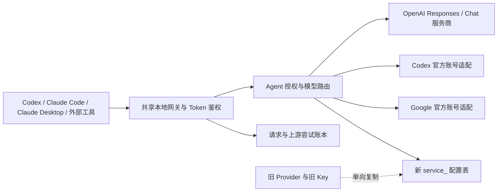

# 服务商配置中心改造与迁移说明

更新日期：2026-11-16。本文描述当前实现，替代先前按旧 Provider 表改造、复用旧账号表或整库回滚的草案。实际建表定义以 [schema.sql](../src-tauri/src/core/service_provider_store/schema.sql) 为准。

## 1. 实现目标和边界

服务商配置成为共享资源。每个服务商维护一套上游地址、凭据、模型目录和价格，各 Agent 通过独立授权、默认模型和别名使用它。上游来源支持 OpenAI 兼容 API、GPT / Codex 官方账号和 Google 官方账号三类；普通 API 明确区分 Responses 和 Chat Completions。

旧 `providers`、`provider_keys` 表结构、记录和旧功能实现继续保留。新模式隐藏并拦截旧配置入口，停止旧网关服务；回滚后恢复旧入口。此次没有物理删除旧实现，因为它们是回滚所需的执行路径。旧数据不会因为新配置变更而被回写。

当前保留 14 张 `service_` 表，运行模式、代际和 schema 版本存入既有 `app_metadata`。官方账号直接存入 `service_provider_configs`，以 `kind` 区分 API、Codex 和 Google 来源，不再单独创建账号表。迁移批次、模式切换和兼容性测试统一存入 `service_operations`，以 `operation_type` 区分，当前 schema 版本为 5。服务商模式下，配置、账号凭据、路由和请求账本均从新表读取；助手、翻译和图片选择器使用新表投影，兼容原有来源 ID。

## 2. 架构和授权




共享网关绑定 `127.0.0.1:15724`，避开旧 Codex、Claude 和 Claude Desktop 的默认端口 15721～15723。端口由后端常量统一定义，界面和客户端生成器从后端状态读取。若端口被其他程序占用，启用失败并显示错误，不抢占其他程序。

| Agent 标识 | 使用方式 | 入站协议 |
| --- | --- | --- |
| codex | 接管指定 Codex 配置目录，或应用内文本调用 | Responses |
| claude | 接管 Claude Code 配置目录 | Messages |
| claude-desktop | 使用现有 Desktop 路径解析和配置生成器 | Messages |
| gateway | 为外部工具签发独立调用 Token | Responses、Chat、Messages、Gemini |

授权链为：调用 Token → 实例 → 服务商 → Agent 授权 → 同一服务商内的模型。Token 不能选择其他服务商；关闭 Agent 授权、禁用或删除服务商、撤销 Token、实例未同步、Token 过期均拒绝调用。API Key 与官方 access token 只在出站时使用，不下发给 Agent。

Token 只保存 SHA-256 哈希和可识别前缀；工具 Token 明文只在生成时展示一次。接管文件需要包含本地 Token，因此加密文件备份也包含它。状态列表排除凭据；文件备份对照是用户主动查看时解密的本机接口。

网关接受 Bearer、x-api-key 和 x-goog-api-key 请求头中的本地 Token，分别兼容现有 OpenAI、Messages 和 Gemini 客户端。每种方式都执行相同的实例与授权检查。

模型解析顺序：已启用的 Agent 显式别名 → Desktop 档位映射（仅 Desktop）→ 同服务商内同名物理模型 → 请求未传模型时的实例模型。显式别名或 Desktop 映射目标禁用、缺失时直接拒绝，不能退回同名物理模型。默认模型、别名、实例和账本模型均用复合外键约束所属服务商；Agent 选项中的模型名称另在保存事务和应用时校验所属服务商及可用状态。

## 3. 配置契约

新增普通服务商时填写名称、API 基础地址、上游协议、API Key 和模型。支持代理、自定义请求头、备注与多个逻辑 Key；保存 API Key 留空表示保留原值。认证头、Host、Content-Length 和连接控制头不能放进自定义请求头。

服务商图标沿用旧 Provider 的 `icon` 配置、现有 `AiIcon` 渲染组件及共享 `ProviderIconPicker`，支持内置图标搜索、图片上传与清空。首次迁移同步图标；已有 schema 1 数据库先增加 `icon` 并依据迁移映射补齐缺失图标；schema 1/2 先升级新模式配置表的类型约束以支持 `google_account`，保留所有 ID、配置修订号及关联记录，并检查外键完整性。schema 1/2/3 随后合并官方账号，schema 1/2/3/4 再合并操作审计，全部在同一事务内完成后升级至 5。升级不改写旧 `providers`、`provider_keys`，不覆盖新模式已保存的非空图标；之后保存时省略 `icon` 会保留现有值，空字符串表示主动清空。

普通上游必须是完整 HTTP/HTTPS 地址，禁止 URL 用户名密码、查询参数、片段及共享网关自身地址。GPT 与 Google 官方账号分别复用项目现有官方适配逻辑，其地址字段不用于任意转发。

服务商模型目录复用原模型列表编辑器，支持添加、批量编辑和获取上游模型。高级配置中的模型 JSON 也可填写名称数组；已有模型按名称重新保存时保留其价格和目录元数据。移除模型表示停用，历史记录继续保留。完整模型示例：

```json
[
  {
    "upstreamModelId": "upstream-model",
    "displayName": "常用模型",
    "enabled": true,
    "contextWindow": 200000,
    "catalog": {},
    "inputPriceMicros": 2000000,
    "cachedInputPriceMicros": 1000000,
    "outputPriceMicros": 8000000,
    "currency": "USD"
  }
]
```

价格是“每百万 Token 的货币微单位”，2000000 表示 2.00 USD / 百万 Token。未知价格填写 null，不能用 0 代替。模型对象保存按提交字段更新；禁用已有模型用 enabled=false，从数组中省略模型不会删除历史模型。

顶部默认打开“Agent 列表”，仅展示检测到的 Codex、Claude Code、Claude Desktop。左侧导航底部不再重复展示 Detected CLI。Agent 页隐藏“查看禁用”和“添加”，这两个操作保留在“服务商”“官方账号”页。服务商名称后仅显示实际接管成功的 Agent，不再显示“可用 / 已停用”状态胶囊。禁用图标继续保留；禁用会撤销 Token、关闭授权并恢复客户端文件，恢复冲突会保留备份且停止访问。

每个 Agent 的“配置”按钮打开独立弹框，选择使用的服务商或官方账号，并编辑本 Agent 的模型规则。来源下拉框只显示启用项；禁用项不展示，缺少凭据的启用项显示待配置提示且不可选择，空分类不展示。保存经 revision、凭据、模型归属及参数验证后，恢复此 Agent 原有全部外部客户端接管，再应用所选来源。同一 Agent 不能同时接管两个服务商，内部会话与测试实例不占用此客户端限制。选择“停止使用”恢复原配置；每个来源的模型参数仍保留。多协议工具授权在网关管理中单独配置，Token 仍按实例管理。

官方额度在进入“官方账号”列表时查询，仅请求启用且已有凭据的账号。Agent 页、服务商页、来源下拉框和普通状态同步只读缓存；官方页刷新按钮可重新查询。批次和单账号请求去重，离开官方页后不再查询批次中的后续账号，已发出的请求可以完成。额度接口失败保留已有缓存并继续处理其他账号；历史 Usage 与本地网关统计不受影响。

服务商编辑弹框只维护基础信息、公共模型目录和高级配置。添加入口可选择 API、GPT / Codex 官方账号、Google 账号；新建官方账号保存后直接登录，登录未完成仍可在详情中继续登录，GPT 还可导入 auth.json。官方目录不提供手工增删或同步开关；Google 的目录由官方刷新并自动供 Codex 引用，GPT 沿用客户端官方目录。Agent 配置保存保留 API Key、模型目录、别名和其他 Agent 参数；`defaultModelName` 由后端解析为本服务商模型 ID，原有调用方仍可传 `defaultModelId`。编辑服务商移除模型时同步清理对应的模型引用。别名示例：

```json
[
  {
    "agentType": "claude",
    "clientModelName": "sonnet",
    "modelId": "新表中已有模型的ID",
    "enabled": true
  }
]
```

提交 routes 数组会替换该服务商的全部别名，因此编辑时应保留需要的其他别名。各 Agent 参数保存在现有新表 `service_provider_agent_bindings.options_json`，本次无需修改旧表或增加数据库列。界面以可视化字段编辑这些参数，避免再维护一份可独立修改的 Agent 参数 JSON。

| Agent | 字段 | 类型与规则 |
| --- | --- | --- |
| Codex | `syncModelList` | boolean，是否将服务商可用模型目录同步到 Codex；新建默认 false，首次迁移复制旧 `sync_model_list` |
| Codex | `modelReasoningEffort` | null 或 minimal / low / medium / high / xhigh / ultra / none；沿用原 Provider 规则，仅 gpt-5.6-sol / gpt-5.6-terra 提供 ultra，应用到其他模型时降为 low |
| Codex | `serviceTierFast`、`modelContextWindowEnabled` | boolean，分别控制 Fast 和 1M 上下文；兼容旧迁移的 0/1/null |
| Codex | `modelAutoCompactTokenLimit` | null 或正整数，1M 开启时生效，未设置采用 900000 |
| Claude Code | `haikuModel`、`sonnetModel`、`opusModel`、`subagentModel` | 模型名称字符串，空值跟随该 Agent 主模型，分别写入对应 env |
| Claude Desktop | `modelMappings` | 对象，键使用现有四档安全模型名，映射值字段见下方示例 |
| 多协议工具 | 无额外 options | 使用默认模型与已有显式模型别名 |

Desktop 映射示例：

```json
{
  "modelMappings": {
    "claude-sonnet-4-6": { "model": "upstream-model", "labelOverride": "常用模型", "supports1m": false },
    "claude-opus-4-8": { "model": "another-model", "labelOverride": "", "supports1m": true },
    "claude-fable-5": { "model": "", "labelOverride": "", "supports1m": false },
    "claude-haiku-4-5": { "model": "", "labelOverride": "", "supports1m": false }
  }
}
```

Desktop 空档位按现有档位顺序继承首个已配置档位的模型与 1M 能力；显式设置的 `supports1m` 优先，显示名称也可单独覆盖。全部留空时使用应用时选择的默认模型。客户端 profile 使用安全档位名，网关通过同一映射函数转成真实上游名称。既有新模式配置未包含 `modelMappings` 时保留原模型目录行为，首次编辑保存后使用新规则。

所有 Agent 共用服务商模型目录。API 服务商获取上游模型后，Codex 列表及其他 Agent 的模型下拉框立即使用同一份目录；Codex 区域只读展示目录并支持选择默认模型与切换同步，不提供添加、批量编辑、删除或获取按钮，目录维护统一在服务商模型目录完成。API 服务商的 Codex 开启同步时，将本服务商全部可用模型写入 `.ai_manager_service_models.json` 并写入 `model_catalog_json`。关闭同步时移除目录引用，不写新的目录文件。官方账号显示“使用官方模型列表”，隐藏模型列表编辑、获取和同步入口。GPT 账号沿用客户端官方目录；Google 将官方返回的可用模型自动写入目录供 Codex 引用，不使用 API 来源的同步开关。解除接管仍按原备份恢复。既有 API 新模式配置缺少 `syncModelList` 时保持此前默认同步的行为；旧 `options.modelList` 仅保留类型兼容，不参与同步筛选或模型引用校验，首次编辑保存会移除该字段，旧空数组不会阻止同步。未知字段、错误类型、跨服务商的生效模型引用以及启用 Agent 引用停用模型均明确拒绝。

保存使用 provider.revision 比较更新，过期页面不能覆盖新修订。配置或模型目录更新后，已接管实例会进入 pending；需要解除接管、检查恢复结果后重新应用。外部工具 Token 不依赖客户端文件，每次请求仍重新校验服务商、Agent 和模型。

编辑会回填当前 Key 的逻辑标识与名称，API Key 留空保留原凭据。获取上游模型前检查连接信息及 revision，连接信息有未保存修改时要求先保存；获取后只合并新增目录项，保留尚未保存的价格、名称与授权，不覆盖其他编辑。

## 4. 迁移规则

迁移是可重复执行的单向复制。用户在“设置 → 系统设置”开启“共享服务商模式”时，后端自动执行复制，复制成功后才提交新模式；迁移失败保持旧模式。单独的 migrate 接口仍可用于诊断，复制本身不改客户端文件。

1. 初始化新表，先记录一次迁移运行。
2. 在 IMMEDIATE 事务中直接读取受支持结构的旧表；不调用旧 Provider 初始化或保存接口。
3. 复制旧 Codex API 服务商、Codex 官方账号和 Google 账号；其他 Agent 来源记为 skipped。官方身份与凭据写入 `service_provider_configs` 的账号字段，Google OAuth 加密保存；旧 OAuth 字段、Key 和 Usage 只读。已经处于新模式的用户也会自动补齐此前未迁入的 Google 账号。
4. 复制名称、地址、代理、请求头、备注、启用状态、Key 版本、官方账号凭据及额度、模型目录、默认模型和 Codex 参数，包括 `syncModelList`。旧模型名称统一合入服务商模型目录，不再保存独立 Codex 子列表。已完成迁移的配置不回填覆盖，缺失字段按上述兼容规则处理。
5. 迁移后默认仅 Codex 授权开启，Claude Code、Claude Desktop 关闭；工具授权需自行开启。
6. 保留旧存储 ID。旧官方账号存储 ID 通常为 account:原ID，新表保留它；前端公开账号 ID 去掉一层前缀，并提供 serviceProviderId。后台同时接受历史公开 ID 和带前缀的存储 ID。
7. 已复制或凭据不可读的来源再次迁移只记 already_copied，不覆盖新模式修改，也不复活已软删除配置。
8. 源 Key 缺失、解密失败或账号凭据不完整记为 unreadable；保留可审查的配置，用户在新入口补录凭据。该状态不会在后续迁移中自动重试覆盖。
9. 单项业务数据导致整次复制失败时回滚复制事务，运行记录保留 failed；旧表始终不变。

旧地址以 /chat/completions 结尾时识别为 Chat，其余迁为 Responses，需在迁移报告后人工核对。旧 Usage 数据原地保留并继续查询，不复制进新网关账本。旧本地 Token、客户端启用态和代理实例不迁入新表。

schema 4 账号合并步骤：先为配置表增加账号字段，将 `service_provider_accounts`、`service_google_accounts` 中的全部账号迁入，再移除这两张账号子表。Codex 凭据无法解密、配置归属不正确、字段约束不满足等任一步失败都会回滚，原账号表与原数据保留。Google OAuth 原密文、适配器本地 Key、模型和额度元数据原样迁移，配置表到期时间统一为 Unix 毫秒。这一步将表数从 18 减为 16。

schema 5 操作合并步骤：将 `service_provider_migrations`、`service_switch_operations`、`service_compatibility_tests` 分别以 migration、switch、compatibility 类型迁入 `service_operations`；原 ID、状态、时间、模式代际、测试配置修订和证据全部保留。迁移明细继续独立，重建其外键指向统一操作表并限定 migration 类型，原明细 ID、幂等索引保持。全部迁入且外键检查通过后移除三张旧审计表，写入版本 5，表数从 16 减为 14。schema 1～4 可直接升级到 5，中间步骤在一个事务内完成；出现缺失父记录等错误时，表结构、原数据和版本一起回滚。模型 ID、账号数据、请求账本、旧 Provider、旧 Key 和历史 Usage 保持。

## 5. 启用、接管与回滚

### 5.1 操作顺序

1. 打开“设置 → 系统设置”，开启“共享服务商模式”。
2. 后端先同步尚未入库的旧会话用量，再启动共享网关并自动复制 Codex API 服务商、GPT 官方账号和 Google 账号。有在途请求则拒绝切换；迁移失败时保持旧模式，关闭本次启动的新监听。
3. 成功后显示新模式界面，默认进入 Agent 列表；服务商与官方账号各自维护来源，查看禁用项和添加按钮只在这两个标签显示。服务商名称旁展示已应用的 Agent，保留原 Provider 卡片与图标操作；迁移报告在右上角“网关与 Agent 管理”中。
4. 在服务商 / 官方账号页核对协议、Key、账号、模型与价格；需要新增时选择 API、GPT 官方账号或 Google 账号。
5. 在 Agent 列表点击对应客户端的“配置”，选择使用来源和本 Agent 模型规则，点击“保存并应用”。同一个 Agent 切换来源时先解除旧接管；高级目录管理、恢复冲突与兼容测试仍在网关管理中。
6. 外部工具在“网关与 Agent 管理 → 配置多协议工具”中保存 gateway 授权，再生成独立 Token 并配置后端返回的地址。
7. “用量”始终使用原 Usage 页面，原有筛选、图表、分页、模型费用配置和报表导出继续使用。历史记录与新网关记录统一查询；实例区保留 synced、pending、conflict 状态。

仅启用新模式不会把所有客户端自动指向新网关；必须按实际使用的 Agent 应用。应用内助手与翻译统一经过网关，需要服务商的 Codex 授权及已配置模型。图片工作台继续使用独立图片链路和图片统计。

### 5.2 接管文件

| Agent | 管理内容 |
| --- | --- |
| Codex | config.toml 的模型、目录引用、独立 model_providers.ai_manager_service 节点；API 开启同步或使用 Google 官方目录时另写 .ai_manager_service_models.json |
| Claude Code | settings.json 的模型及相关 env；清除冲突的 ANTHROPIC_API_KEY，写入本地 AUTH_TOKEN、地址和模型 |
| Claude Desktop | 现有路径解析得到的两份 claude_desktop_config.json、configLibrary 下专用 profile 和 _meta.json |

Codex 不写 auth.json；独立 provider 节点使用本地 Bearer、requires_openai_auth=false、supports_websockets=false。顶层 model_provider 固定为 ai_manager_service，上游地址和真实密钥留在服务商新表，由共享网关转发。应用时清理旧模式生成的 model_providers.custom、model_providers.codex_local_access 及其子表，并重建当前 ai_manager_service 节点，避免旧认证字段或地址遗留；openai_base_url 同时移除。完整原文先保存至加密备份，解除接管可恢复原有节点。保留其他用户定义 Provider、MCP、权限和项目配置。Fast、1M 窗口开关关闭时清除对应接管字段，避免遗留选项继续生效。

写入前把原文件存在性、完整内容和哈希，以及待写内容和哈希持久化至新表；内容复用项目现有凭据加密机制。该机制不是操作系统凭据库。先准备记录，再原子写文件，最后标记实例同步。写入前后检查外部变化和配置修订；失败执行恢复，无法自动恢复的文件保留 conflict。

### 5.3 回滚

在“设置 → 系统设置”关闭“共享服务商模式”。流程先暂停新请求，检查在途请求，再撤销实例 Token、逐文件恢复，全部成功后才切换 backend 和 generation，并恢复旧服务入口。失败时开关继续显示实际的新模式状态。

当前文件等于程序写入后的哈希时，可恢复原内容；原文件不存在时删除接管文件。当前内容已经等于原始内容时直接确认恢复。其他变化均保留 conflict，不覆盖外部修改。用户可“查看加密备份”，对照 before/after 手动处理后重试。

回滚仅恢复接管文件和运行模式，不导入迁移前整库快照；新配置、新账本和迁移记录保留。新模式中的修改不会反向同步到旧服务商，回滚看到的是原有旧配置。

schema 5 支持当前程序内切回旧模式。仅支持 schema 4 及更早版本的旧二进制无法读取版本 5；如需换回旧程序，应使用升级前的完整数据备份恢复其数据库，不能将应用内模式回滚视为数据库降级。

回滚中部分实例可能已恢复，其他实例仍有冲突，此时 backend 保持 service，界面展示实际状态。已恢复实例不会自动重新接管。托盘快捷切换先恢复默认目录，再应用目标服务商；新应用失败时保留恢复后的文件状态并报告错误，不自动补偿切回上一服务商。

后台独立 Provider 进程的旧随机代理端口不会在回滚后重建；这些独立客户端需重新启动。默认旧网关按原启用配置重新启动。有接管实例时禁止切换数据根目录、CLI 配置目录及恢复业务备份，避免备份丢失或路径错配。

应用启动时把中断请求记为 unknown，恢复未完成接管，撤销内部临时 Token，把未完成模式切换记为 interrupted。不能把崩溃中断的上游请求当成已确认成功或零用量。

## 6. 请求、用量和费用

- requests 记录一次入站业务请求；鉴权拒绝也记录，模型列表和 health 查询不进入业务账本。
- attempts 记录一次实际发起的上游尝试；当前没有自动重试或自动故障转移，通常一个业务请求至多一个尝试。
- 转换失败或授权拒绝可以有 request 而没有 attempt，不能算成上游消费。
- 输入、输出、缓存、推理 Token 均单独存储。上游未返回的字段为 NULL；真实 0 与未知区分。
- 缓存输入是输入 Token 的子集，推理 Token 是输出细分，不再次加到总 Token。
- 发送时冻结服务商名称、Key 版本/官方凭据代际、物理模型和价格；后续改名、换 Key、改价不重算历史归属。
- 收到上游响应头即保存状态和 request ID；结算按 finished_at 幂等，只更新一次。
- 客户端在响应头到达前取消或处理任务中断时，请求上下文退出会关闭遗留在途记录，状态记为 unknown，未观测用量保持 NULL，避免阻塞解除接管和模式切换。流式上下文持续到转发任务结束。
- 统计支持服务商、Agent、模型、Key/凭据版本、本地 Token、本地日期六个维度。分组按币种分别汇总，已知 Token 和已计价次数同时展示。
- 汇总表的费用是“已计价部分之和”，应结合 pricedCount / attemptCount 判断覆盖率；不能当作完整账单。缺字段的单次费用保留 NULL。
- 悬浮窗和 Usage 页面使用同一查询接口，按原有应用、日期范围汇总新旧记录，切换模式不清零当日统计。

Usage 兼容查询只读取并投影新账本，不删除、搬移或重新归属原 Usage 记录。查询不依赖当前 backend，因此回滚后仍可查看新模式期间的调用。新模式在网关收到请求时登记，响应和流结束时直接结算；Usage 刷新、待处理用量同步和 Skill 分析均不再扫描客户端请求日志，也不执行旧用量解析器升级或旧 Key 绑定。原 Usage 页面、筛选、分页、费用配置及导出继续共用，新模式按钮显示“刷新用量”。旧模式继续扫描日志；从旧模式首次切换前仍做最后一次旧用量同步。

回滚后重新扫描客户端日志时仍须避免重复计数：Claude Messages 转换响应使用由网关请求 ID 派生的 `msg_aim_...` 标识，与 Claude 会话按响应 ID 对应；Desktop 回合全部由这些响应组成时保留会话行并标记来源，由网关账本参与统计。Codex token_count 没有响应 ID，按已接管配置目录与对应接管/恢复时段选用网关账本；旧模式扫描的未接管目录与接管前、恢复后的会话继续参与原统计。新模式只新增经过网关的调用，不补扫直连请求。接管期间应通过网关使用该目录，手动改回直连前应先解除接管。Windows 普通路径与 `\\?\` 路径统一比较。

Skill 使用也由网关入站请求采集：识别用户显式 `$skill` / `/skill` 引用、`Skill` 工具调用，以及工具参数中的 `skills/.../SKILL.md` 和 `skill://...` 加载资源。只遍历会话消息和工具调用；系统提示、工具定义、技能目录说明、工具返回正文及普通助手说明不作为调用证据。只存技能别名、事件摘要及请求关联，不存请求正文、工具参数或文件路径。

Skill 事件优先使用客户端会话标识与稳定消息 / 工具调用 ID 去重；没有调用 ID 时使用该消息之前的历史前缀摘要，同一历史追加、重发不会重复登记已有事件。支持常见会话请求头、`metadata.session_id` / `metadata.conversation_id`，以及 `metadata.user_id` 中 JSON 格式的 session_id 或 `_session_...` 后缀。Claude 斜杠命令的 `<command-name>` 标签也按显式引用处理。缺少会话标识时的 `history` 范围是推断：完全相同且没有任何稳定 ID 的独立会话可能合并，不能保证客户端内部真实调用次数；网关未收到的调用也无法统计。事件时间是网关首次观测时间，不回填为客户端实际执行时间。

Skill 页面合并旧调用缓存与新事件。请求数、Token 和费用通过新事件与请求 ID 的关联查询同一网关账本，沿用最近一次已观测技能之后的请求口径；同次引用多个技能时，共同关联请求的费用不能当作各技能的独立收费再相加。Responses 增量请求只在提供 `previous_response_id` 且同一实例有对应响应记录时继承关联；没有证据时不猜测归属。`usageCount` 表示可观测的引用 / 调用事件数，不表示 Skill 运行成功次数或 Skill 自身精确计费。

新增采集器首次初始化时在 `app_metadata` 记录 `service_gateway:skills_started_at`。回滚后本地日志扫描恢复；兼容读取根据成功的模式切换时段排除新采集器上线后、新模式期间的 Skill 日志副本，避免与网关事件重复统计。已有旧调用缓存原地保留，上线前及旧模式期间的历史继续查询。会话管理为展示会话读取文件、Skill 清单为展示已安装技能读取目录，均与模型请求日志采集分开。

新日志的未知 Token、费用保持 NULL，原表格显示“未知”。汇总保留已知小计，全部未知时显示未知，并通过现有卡片提示说明缺失请求数。CNY 估算按 Usage 的汇率转换为 USD 后参与原费用切换。未配置服务商单价时继续使用 Usage 原有模型费用；修改模型费用前冻结历史网关估算，只更新新账本中的估算和费用来源快照。

费用按以下规则计算，结果是整数货币微单位并向上取整：

```text
非缓存输入 = input_tokens - cached_input_tokens
估算费用微单位 = ceil((非缓存输入 × input_price_micros
                   + 缓存输入 × cached_input_price_micros
                   + output_tokens × output_price_micros) / 1000000)
```

需要完整输入、输出、缓存用量及对应价格；缓存为 0 时不要求缓存单价。账本是网关观测与估算，官方额度、供应商结算账单及图片统计各自保留，不冒充上游账单。配置中心的网关诊断显示最近 100 条请求明细，原 Usage 页面按原分页与导出流程查询全部兼容记录；没有新增自动清理逻辑。

## 7. 业务备份与凭据

业务备份新增服务商配置、模型、Agent 授权和别名四张表；不包含新 Key、官方 token、本地调用 Token、实例、接管文件备份、迁移记录、请求账本及 Skill 事件 / 请求关联。配置表中的 11 个账号本机字段（见 10.1）在读取备份源数据时直接替换为默认值，身份、邮箱、凭据、代际、额度、Google 元数据及适配器字段均不进入业务备份。导出的新服务商和授权均关闭，恢复后补录凭据并明确启用。

恢复按父子表顺序进行，以 provider+upstream_model、provider+agent、provider+agent+alias 的自然键合并，保留本地主键并重映射模型外键。已有配置保留本机启用、软删除状态及全部账号本机字段，配置 revision 递增，不允许改变来源类型；新配置的账号字段使用默认值。即使备份包含账号密文也不导入，恢复预览也不比较和展示这些字段。模式、generation 等本机 app_metadata 不随业务备份恢复。

业务备份仍保留兼容旧业务表的范围；新模式恢复过滤旧 Provider 和旧凭据旁路，不会把旧来源写回新运行链路。需要灾难恢复凭据和完整审计数据时，应在应用关闭、SQLite WAL 一致的条件下备份整个配置数据根目录；这与页面业务备份和“回滚旧模式”是不同操作。

## 8. 接口和代码位置

统一沿用项目现有 IPC 请求层，新增 service-provider 命名空间：state、detail、save、delete、migrate、switch-backend、activate、detach、quick-switch、fetch-models、test、issue-token、key-select、key-revoke、import-account、login、cancel-login、refresh-quota、file-backup、period-usage。

| 位置 | 职责 |
| --- | --- |
| src-tauri/src/core/service_provider_store.rs | 新存储、校验、Key/账号加密、目录投影和统计 |
| src-tauri/src/core/service_provider_store/schema.sql | 14 张新表的唯一建表定义 |
| src-tauri/src/core/service_provider_store/migration.rs | 旧 Provider 只读、单向幂等复制，以及 schema 4 账号合并、schema 5 操作审计合并升级 |
| src-tauri/src/api/service_provider.rs | 配置操作、接管、恢复和模式切换 |
| src-tauri/src/api/multi_protocol_gateway/service.rs | 鉴权、路由、attempt、结算、模型获取和兼容测试 |
| src-tauri/src/core/state.rs | 生命周期、旧入口隔离与状态事件 |
| src-tauri/src/core/database.rs 和 database/restore.rs | 业务备份范围与外键映射 |
| src/features/providers/components/ServiceProviderCenter.vue | 新配置中心、迁移报告与网关诊断 |
| src/features/settings/components/SystemSettings.vue | 共享服务商模式开关 |
| src-tauri/src/api/usage/service.rs | 新账本到原 Usage 的只读投影、去重与费用兼容 |
| src-tauri/src/api/usage/gateway_skills.rs | 网关 Skill 事件识别、历史重发去重及请求关联 |
| src/features/usage/index.vue | 继续使用原 Usage 页面、筛选和导出 |
| src/api/modules/service-providers.js | 复用原请求层的 API 包装 |

## 9. 当前协议能力和验证范围

复用既有协议转换与 SSE 内核，提供 Responses / Chat / Messages / Gemini 入站到 Responses / Chat 上游的转换。原生 Responses 请求保留原始字段；跨协议无法表达的语义明确拒绝。仅 HTTP，未提供 WebSocket。

/responses/compact 和 /v1/responses/compact 只允许 Responses 上游原生透传，Chat 上游返回 422，stream=true 返回 400。真实 Agent 若使用其他专用能力，需在对应客户端版本继续验收；“OpenAI 兼容”不能保证所有扩展字段等价。

配置中心的兼容测试验证“工具调用 → 工具结果 → SSE 文本”，记录服务商修订、Agent 版本、适配器版本与能力。它会发起真实测试请求并进入账本，可能消耗上游额度；不启动真实 Codex、Claude Code 或 Desktop 进程。

自动验证使用临时数据库和本机模拟上游，覆盖旧表写保护、幂等迁移、凭据版本、官方账号 ID、授权隔离、协议矩阵、compact、未知用量、统计币种、文件冲突、回滚、备份和前端交互。没有操作真实用户数据库、执行真实 OAuth 登录或调用真实计费上游；不宣称完成真实客户端联调或安装包验证。

额外回归覆盖：没有旧 Provider 表时的主状态生成和刷新、模型获取期间修订变化、刷新目录保留本地价格与启用状态、客户端等待响应头时取消后可以回滚。同一官方身份轮换令牌保留额度缓存，更换官方身份则清空旧额度；额度查询结果按发起查询时的凭据代际写入，不能覆盖重新导入后的账号。

复验命令：

```powershell
cd src-tauri
cargo test --lib service_ --offline -- --test-threads=1
cargo test --lib api::proxy::tests --offline -- --test-threads=1
cargo test --lib api::multi_protocol_gateway::tests --offline -- --test-threads=1
cargo test --lib core::database::tests --offline -- --test-threads=1
cargo test --lib api::data::tests --offline -- --test-threads=1
cargo test --lib api::claude_desktop::tests --offline -- --test-threads=1
cargo test --lib api::codex_account::tests --offline -- --test-threads=1
cargo test --lib api::image_workbench::tests --offline -- --test-threads=1
cd ..
node scripts/test-service-providers.mjs
```

## 10. 完整新表字段字典

以下逐字段列出实际 SQL 类型、空值规则、默认值、字段约束与含义，并列出表级外键和唯一索引。所有表为 SQLite STRICT；布尔值使用整数 0/1，所有时间戳使用 UTC Unix 毫秒。没有 DEFAULT 的必填字段须由写入方提供；可空且无 DEFAULT 的字段默认 NULL。SQL 枚举以本节列出的约束为准，Agent 类型等业务白名单还受写入 API 校验。

### 10.1 service_provider_configs

用途：服务商主配置及官方账号存储。`kind=api` 使用 `service_provider_keys` 管理多个逻辑 Key；`kind=codex_account/google_account` 使用本表账号字段。以下从 `account_id` 到 `google_gateway_port` 的 11 个字段属于本机数据，不参与业务备份和覆盖恢复。

| 字段 | 类型 | 可空 | 默认值 | 含义 | SQL 字段约束 |
| --- | --- | --- | --- | --- | --- |
| `id` | TEXT | 否 | 无 | 本表稳定主键；新建由应用生成，迁移服务商保留旧存储 ID | `PRIMARY KEY` |
| `name` | TEXT | 否 | 无 | 界面显示名称 | `CHECK(length(trim(name))>0)` |
| `icon` | TEXT | 否 | `''` | 沿用旧 Provider 的图标名称或自定义图片地址；空串使用默认展示 | — |
| `kind` | TEXT | 否 | 无 | 来源类型：api、codex_account、google_account | `CHECK(kind IN ('api','codex_account','google_account'))` |
| `upstream_protocol` | TEXT | 否 | 无 | 上游协议；普通 API 可为 responses/chat，官方账号固定 responses | `CHECK(upstream_protocol IN ('responses','chat'))` |
| `base_url` | TEXT | 否 | `''` | 普通 API 的基础地址；官方账号不使用任意自定义上游 | — |
| `proxy` | TEXT | 否 | `''` | 出站代理地址；空串按项目默认网络行为 | — |
| `headers_json` | TEXT | 否 | `'{}'` | 额外出站请求头 JSON 对象；认证和连接控制头由程序管理 | `CHECK(json_valid(headers_json) AND json_type(headers_json)='object')` |
| `note` | TEXT | 否 | `''` | 用户备注 | — |
| `enabled` | INTEGER | 否 | `1` | 启用状态；还需通过服务商、Agent、实例和凭据的其他校验 | `CHECK(enabled IN (0,1))` |
| `revision` | INTEGER | 否 | `1` | 服务商配置乐观并发修订号；账号刷新和额度更新不递增，避免使已应用配置变为过期 | `CHECK(revision>0)` |
| `account_id` | TEXT | 否 | `''` | 官方身份；Codex account_id 或 Google subject；未登录和 API 来源为空 | — |
| `account_email` | TEXT | 否 | `''` | 官方账号展示邮箱 | — |
| `credentials_ciphertext` | TEXT | 否 | `''` | 按 kind 区分格式的加密凭据 JSON；空串表示未登录 | — |
| `token_expires_at` | INTEGER | 是 | NULL | 凭据到期时间，统一为 Unix 毫秒；未知为 NULL | — |
| `credential_generation` | INTEGER | 否 | `0` | 官方凭据代际，初始未登录为 0，保存和刷新递增，用于并发校验与账本归属 | `CHECK(credential_generation>=0)` |
| `refresh_status` | TEXT | 否 | `''` | 最近凭据刷新状态；当前成功保存清空，未实现完整失败状态机 | — |
| `quota_json` | TEXT | 否 | `'{}'` | Codex 最近官方额度响应；与网关实际用量分开 | `CHECK(json_valid(quota_json))` |
| `account_updated_at` | INTEGER | 是 | NULL | 最近账号凭据、身份或额度元数据更新时间，Unix 毫秒 | — |
| `account_metadata_json` | TEXT | 否 | `'{}'` | Google 官方 models、project、plan、quotaGroups、状态及提示等账号元数据 | `CHECK(json_valid(account_metadata_json) AND json_type(account_metadata_json)='object')` |
| `google_local_key_ciphertext` | TEXT | 否 | `''` | Google 本地适配器认证令牌密文；同一身份重新登录保留，身份变化重新生成 | — |
| `google_gateway_port` | INTEGER | 是 | NULL | Google 本地适配器端口；共享入口仍为 15724，其他来源为空 | `CHECK(google_gateway_port BETWEEN 1 AND 65535)` |
| `deleted_at` | INTEGER | 是 | 无 | 软删除时间；NULL 表示未删除 | — |
| `created_at` | INTEGER | 否 | 无 | 创建时间，Unix 毫秒 | — |
| `updated_at` | INTEGER | 否 | 无 | 最后更新时间，Unix 毫秒 | — |

表级约束与索引：

```sql
CHECK(kind='api' OR upstream_protocol='responses')
CREATE UNIQUE INDEX IF NOT EXISTS service_config_google_subject
ON service_provider_configs(account_id)
WHERE kind='google_account' AND account_id<>'';
```

Google 非空 subject 在全部配置中唯一，包含软删除记录，沿用升级前的重复账号限制；多条待登录配置允许使用空身份。普通配置保存不接收或覆盖账号字段。刷新凭据按 `credential_generation` 比较更新，额度查询按发起时的代际写入；账号更新只改变账号时间及必要的凭据代际，不改变服务商配置的 `revision`、`updated_at`。

`credentials_ciphertext` 解密后的格式：

| 来源 | JSON 内容 | 时间规则 |
| --- | --- | --- |
| Codex | `access_token`、`refresh_token`、`id_token` 字符串；后两项按已有导入规则可为空 | 到期时间单独存入 `token_expires_at`，Unix 毫秒 |
| Google | 完整 OAuth 对象，保留 `access_token`、`refresh_token`、`client_id`、`client_secret`、`expires_at` 及现有扩展字段 | OAuth JSON 内 `expires_at` 保留现有 Unix 秒格式；写入配置表时转换为毫秒 |

### 10.2 service_provider_keys

用途：普通 API Key 的逻辑槽位及版本。

| 字段 | 类型 | 可空 | 默认值 | 含义 | SQL 字段约束 |
| --- | --- | --- | --- | --- | --- |
| `id` | TEXT | 否 | 无 | 本表稳定主键；新建由应用生成，迁移服务商保留旧存储 ID | `PRIMARY KEY` |
| `provider_id` | TEXT | 否 | 无 | 所属服务商主配置 ID | `REFERENCES service_provider_configs(id) ON DELETE RESTRICT` |
| `logical_id` | TEXT | 否 | 无 | 同一服务商内逻辑 Key 槽位标识，轮换凭据时保持不变 | — |
| `name` | TEXT | 否 | `''` | 界面显示名称 | — |
| `note` | TEXT | 否 | `''` | 用户备注 | — |
| `secret_ciphertext` | TEXT | 否 | `''` | 当前 Key 的加密值；旧版本或撤销后清空 | — |
| `encryption_version` | INTEGER | 否 | `1` | 凭据包装版本标识，当前仅接受 1；不表示操作系统凭据保护 | `CHECK(encryption_version=1)` |
| `fingerprint` | TEXT | 否 | 无 | Key 原文 SHA-256；用于版本识别，不是可调用凭据 | — |
| `is_current` | INTEGER | 否 | `1` | 是否为该逻辑 Key 的当前版本 | `CHECK(is_current IN (0,1))` |
| `is_active` | INTEGER | 否 | `0` | 是否为此服务商实际出站使用的 Key | `CHECK(is_active IN (0,1))` |
| `status` | TEXT | 否 | `'active'` | 本表生命周期状态，合法值由 CHECK 列出 | `CHECK(status IN ('active','archived','unreadable','revoked'))` |
| `created_at` | INTEGER | 否 | 无 | 创建时间，Unix 毫秒 | — |
| `updated_at` | INTEGER | 否 | 无 | 最后更新时间，Unix 毫秒 | — |

表级约束与索引：

```sql
UNIQUE(provider_id,logical_id,fingerprint)
UNIQUE(provider_id,id)
CHECK(is_current=1 OR (is_active=0 AND secret_ciphertext=''))
CREATE UNIQUE INDEX IF NOT EXISTS service_keys_current ON service_provider_keys(provider_id,logical_id) WHERE is_current=1;
CREATE UNIQUE INDEX IF NOT EXISTS service_keys_active ON service_provider_keys(provider_id) WHERE is_active=1;
```

### 10.3 Codex 账号合并映射（schema 4）

`service_provider_accounts` 已移除，当前不再建表。升级按原 `provider_id` 定位同类型配置；旧账号表 `id` 不再作为独立实体，配置 ID 继续保持，已有请求账本的凭据快照不改写。

| 升级前账号字段 | 当前配置表字段 | 迁移规则 |
| --- | --- | --- |
| `external_account_id`、`email` | `account_id`、`account_email` | 原值复制 |
| `access_ciphertext`、`refresh_ciphertext`、`id_ciphertext` | `credentials_ciphertext` | 解密三段后合成 10.1 定义的 JSON 并重新加密；不可读则回滚整个升级 |
| `expires_at` | `token_expires_at` | 保留 Unix 毫秒 |
| `token_generation` | `credential_generation` | 保留原代际，后续保存递增 |
| `refresh_status`、`quota_json` | 同名字段 | 原值复制 |
| `updated_at` | `account_updated_at` | 原值复制；配置创建和更新时间保持 |

账号读取接口继续投影原有公开结构，界面、登录和额度入口保持。官方身份变化时清空原 Codex 额度缓存，同一身份换 token 保留缓存。

### 10.4 service_provider_models

用途：服务商模型目录与价格，继续保留独立表。模型与服务商是一对多关系；已有 `usage_pricing_items` 继续作为模型默认价格来源，本表价格字段保存服务商差异覆盖，按现有规则选择价格并冻结到请求账本。

| 字段 | 类型 | 可空 | 默认值 | 含义 | SQL 字段约束 |
| --- | --- | --- | --- | --- | --- |
| `id` | TEXT | 否 | 无 | 本表稳定主键；新建由应用生成，迁移服务商保留旧存储 ID | `PRIMARY KEY` |
| `provider_id` | TEXT | 否 | 无 | 所属服务商主配置 ID | `REFERENCES service_provider_configs(id) ON DELETE RESTRICT` |
| `upstream_model_id` | TEXT | 否 | 无 | 真实上游模型名，服务商内唯一 | `CHECK(length(trim(upstream_model_id))>0)` |
| `display_name` | TEXT | 否 | `''` | 模型展示名称 | — |
| `context_window` | INTEGER | 是 | 无 | 上下文窗口 Token 数；未知为 NULL | `CHECK(context_window>0)` |
| `catalog_json` | TEXT | 否 | `'{}'` | 保留上游模型目录扩展信息的 JSON 对象 | `CHECK(json_valid(catalog_json) AND json_type(catalog_json)='object')` |
| `catalog_schema_version` | INTEGER | 否 | `1` | 目录包装版本，当前写入默认 1 | — |
| `enabled` | INTEGER | 否 | `1` | 启用状态；还需通过服务商、Agent、实例和凭据的其他校验 | `CHECK(enabled IN (0,1))` |
| `input_price_micros` | INTEGER | 是 | 无 | 非缓存输入每百万 Token 的货币微单位单价；未知为 NULL | `CHECK(input_price_micros>=0)` |
| `cached_input_price_micros` | INTEGER | 是 | 无 | 缓存输入每百万 Token 的货币微单位单价；未知为 NULL | `CHECK(cached_input_price_micros>=0)` |
| `output_price_micros` | INTEGER | 是 | 无 | 输出每百万 Token 的货币微单位单价；未知为 NULL | `CHECK(output_price_micros>=0)` |
| `currency` | TEXT | 否 | `'USD'` | 单价和费用币种；默认 USD，不做隐式跨币种相加 | — |
| `created_at` | INTEGER | 否 | 无 | 创建时间，Unix 毫秒 | — |
| `updated_at` | INTEGER | 否 | 无 | 最后更新时间，Unix 毫秒 | — |

表级约束与索引：

```sql
UNIQUE(provider_id,upstream_model_id)
UNIQUE(provider_id,id)
```

### 10.5 service_provider_agent_bindings

用途：服务商对各 Agent 的授权和默认配置。

| 字段 | 类型 | 可空 | 默认值 | 含义 | SQL 字段约束 |
| --- | --- | --- | --- | --- | --- |
| `id` | TEXT | 否 | `(lower(hex(randomblob(16))))` | 本表稳定主键；新建由应用生成，迁移服务商保留旧存储 ID | `PRIMARY KEY  DEFAULT (lower(hex(randomblob(16))))` |
| `provider_id` | TEXT | 否 | 无 | 所属服务商主配置 ID | `REFERENCES service_provider_configs(id) ON DELETE RESTRICT` |
| `agent_type` | TEXT | 否 | 无 | Agent 类型，API 当前接受 codex/claude/claude-desktop/gateway | `CHECK(length(agent_type)>0)` |
| `enabled` | INTEGER | 否 | `0` | 启用状态；还需通过服务商、Agent、实例和凭据的其他校验 | `CHECK(enabled IN (0,1))` |
| `default_model_id` | TEXT | 是 | 无 | 该服务商对当前 Agent 的默认模型 ID；可空 | — |
| `options_json` | TEXT | 否 | `'{}'` | Agent 专有选项对象；当前仅 Codex 支持已声明参数 | `CHECK(json_valid(options_json) AND json_type(options_json)='object')` |
| `revision` | INTEGER | 否 | `1` | 乐观并发修订号，更新递增 | — |
| `updated_at` | INTEGER | 否 | 无 | 最后更新时间，Unix 毫秒 | — |

表级约束与索引：

```sql
UNIQUE(provider_id,agent_type)
FOREIGN KEY(provider_id,default_model_id) REFERENCES service_provider_models(provider_id,id) ON DELETE RESTRICT
```

### 10.6 service_agent_model_routes

用途：各 Agent 的客户端模型别名。

| 字段 | 类型 | 可空 | 默认值 | 含义 | SQL 字段约束 |
| --- | --- | --- | --- | --- | --- |
| `id` | TEXT | 否 | 无 | 本表稳定主键；新建由应用生成，迁移服务商保留旧存储 ID | `PRIMARY KEY` |
| `provider_id` | TEXT | 否 | 无 | 所属服务商主配置 ID | — |
| `agent_type` | TEXT | 否 | 无 | Agent 类型，API 当前接受 codex/claude/claude-desktop/gateway | — |
| `client_model_name` | TEXT | 否 | 无 | 客户端请求的模型别名 | `CHECK(length(client_model_name)>0)` |
| `model_id` | TEXT | 否 | 无 | 所属服务商下的模型 ID；使用复合外键防止跨服务商引用 | — |
| `enabled` | INTEGER | 否 | `1` | 启用状态；还需通过服务商、Agent、实例和凭据的其他校验 | `CHECK(enabled IN (0,1))` |

表级约束与索引：

```sql
FOREIGN KEY(provider_id,agent_type) REFERENCES service_provider_agent_bindings(provider_id,agent_type) ON DELETE RESTRICT
FOREIGN KEY(provider_id,model_id) REFERENCES service_provider_models(provider_id,id) ON DELETE RESTRICT
UNIQUE(provider_id,agent_type,client_model_name)
```

### 10.7 service_operations

用途：统一保存旧配置迁移批次、模式切换审计和配置修订对应的兼容性测试证据。三类操作使用独立字段；每次读取、更新和启动恢复均按 `operation_type` 限定。旧 `service_compatibility_tests` 的全部字段迁入本表，其中 `tested_at` 同时写入 `created_at`、`completed_at`；公开接口仍返回 `testedAt`，原列表不变。

| 字段 | 类型 | 可空 | 默认值 | 含义 | SQL 字段约束 |
| --- | --- | --- | --- | --- | --- |
| `id` | TEXT | 否 | 无 | 操作稳定主键，升级保留原记录 ID | `PRIMARY KEY` |
| `operation_type` | TEXT | 否 | 无 | 操作类型：migration、switch、compatibility | `CHECK(operation_type IN ('migration','switch','compatibility'))` |
| `status` | TEXT | 否 | 无 | 迁移：running/completed/failed；切换：preparing/completed/failed/interrupted；测试：passed/failed/unsupported | 类型与状态通过表级 CHECK 联合校验 |
| `error_message` | TEXT | 否 | `''` | 迁移、切换错误说明；测试具体结果保存在 evidence_json | — |
| `created_at` | INTEGER | 否 | 无 | 操作创建时间；旧测试使用原 tested_at，Unix 毫秒 | — |
| `completed_at` | INTEGER | 是 | NULL | 迁移、切换完成时间；测试必须提供，Unix 毫秒 | 测试类型不可为空 |
| `source_schema` | TEXT | 否 | `''` | 迁移识别的旧结构，当前为 providers-v1，其他类型为空 | — |
| `from_backend` | TEXT | 是 | NULL | 切换前模式；切换类型必须填写 | `CHECK(from_backend IN ('legacy','service'))` |
| `to_backend` | TEXT | 是 | NULL | 切换目标模式；切换类型必须填写 | `CHECK(to_backend IN ('legacy','service'))` |
| `generation` | INTEGER | 是 | NULL | 切换对应运行模式代际；切换类型必须填写 | 表级 CHECK |
| `provider_id` | TEXT | 是 | NULL | 测试所属服务商；测试类型必须填写 | 表级 CHECK |
| `agent_type` | TEXT | 是 | NULL | 测试 Agent；测试类型必须填写 | 表级 CHECK |
| `model_id` | TEXT | 是 | NULL | 测试模型；测试类型必须填写，复合外键限制服务商归属 | 表级 CHECK |
| `provider_revision` | INTEGER | 是 | NULL | 测试执行时的配置修订；测试类型必须填写 | 表级 CHECK |
| `agent_version` | TEXT | 否 | `''` | 测试客户端版本字符串 | — |
| `adapter_version` | INTEGER | 否 | `1` | 协议适配器版本，当前默认 1 | — |
| `client_protocol` | TEXT | 否 | `''` | 测试入站协议 | — |
| `upstream_protocol` | TEXT | 否 | `''` | 测试上游协议 | — |
| `capability` | TEXT | 否 | `''` | 测试能力名，当前为 tool_roundtrip_stream | — |
| `evidence_json` | TEXT | 否 | `'{}'` | 测试结果与实例 ID 等证据 JSON；不存完整对话正文 | `CHECK(json_valid(evidence_json))` |

表级约束与索引：

```sql
UNIQUE(id,operation_type)
FOREIGN KEY(provider_id,agent_type) REFERENCES service_provider_agent_bindings(provider_id,agent_type) ON DELETE RESTRICT
FOREIGN KEY(provider_id,model_id) REFERENCES service_provider_models(provider_id,id) ON DELETE RESTRICT
CREATE INDEX IF NOT EXISTS service_operations_recent ON service_operations(operation_type,created_at DESC,id);
```

启动恢复只把 `operation_type='switch'` 且尚未完成的记录标记为 interrupted。Skill 历史去重只读取已完成的 switch 记录来确定新模式时段，迁移和测试不会参与时段判断。操作审计属于本机数据，不进入业务备份和恢复。

### 10.8 service_agent_instances

用途：客户端目录或内部/外部调用实例。

| 字段 | 类型 | 可空 | 默认值 | 含义 | SQL 字段约束 |
| --- | --- | --- | --- | --- | --- |
| `id` | TEXT | 否 | 无 | 本表稳定主键；新建由应用生成，迁移服务商保留旧存储 ID | `PRIMARY KEY` |
| `agent_type` | TEXT | 否 | 无 | Agent 类型，API 当前接受 codex/claude/claude-desktop/gateway | `CHECK(length(agent_type)>0)` |
| `name` | TEXT | 否 | 无 | 界面显示名称 | — |
| `config_path` | TEXT | 否 | 无 | 规范化配置目录；内部/测试/外部实例使用 internal:/test:/external: 前缀标识 | — |
| `agent_version` | TEXT | 否 | `''` | 客户端版本字符串；未检测或未提供时为空 | — |
| `client_protocol` | TEXT | 否 | 无 | 实例或测试的入站协议；all 仅用于多协议工具实例 | `CHECK(client_protocol IN ('responses','messages','chat','all'))` |
| `provider_id` | TEXT | 是 | 无 | 所属服务商主配置 ID | — |
| `model_id` | TEXT | 是 | 无 | 所属服务商下的模型 ID；使用复合外键防止跨服务商引用 | — |
| `status` | TEXT | 否 | `'detached'` | 本表生命周期状态，合法值由 CHECK 列出 | `CHECK(status IN ('detached','active','error'))` |
| `sync_status` | TEXT | 否 | `'pending'` | 实例同步状态：pending/synced/conflict/restored | `CHECK(sync_status IN ('pending','synced','conflict','restored'))` |
| `applied_revision` | INTEGER | 是 | 无 | 接管成功时的服务商修订；尚未应用为 NULL | — |
| `applied_hash` | TEXT | 否 | `''` | 接管文件路径与 after 哈希组合后得到的摘要 | — |
| `last_synced_at` | INTEGER | 是 | 无 | 最后成功同步时间，Unix 毫秒 | — |
| `last_error` | TEXT | 否 | `''` | 实例最近一次错误说明 | — |
| `revision` | INTEGER | 否 | `1` | 乐观并发修订号，更新递增 | — |
| `created_at` | INTEGER | 否 | 无 | 创建时间，Unix 毫秒 | — |
| `updated_at` | INTEGER | 否 | 无 | 最后更新时间，Unix 毫秒 | — |

表级约束与索引：

```sql
FOREIGN KEY(provider_id,model_id) REFERENCES service_provider_models(provider_id,id) ON DELETE RESTRICT
FOREIGN KEY(provider_id,agent_type) REFERENCES service_provider_agent_bindings(provider_id,agent_type) ON DELETE RESTRICT
CHECK(status<>'active' OR (provider_id IS NOT NULL AND model_id IS NOT NULL))
CHECK((provider_id IS NULL)=(model_id IS NULL))
UNIQUE(agent_type,config_path)
```

### 10.9 service_gateway_tokens

用途：绑定实例的本地调用凭据哈希。

| 字段 | 类型 | 可空 | 默认值 | 含义 | SQL 字段约束 |
| --- | --- | --- | --- | --- | --- |
| `id` | TEXT | 否 | 无 | 本表稳定主键；新建由应用生成，迁移服务商保留旧存储 ID | `PRIMARY KEY` |
| `token_hash` | TEXT | 否 | 无 | 本地调用 Token 的 SHA-256，不保存 Token 明文 | `UNIQUE` |
| `token_prefix` | TEXT | 否 | 无 | 仅用于展示识别的 Token 前缀 | — |
| `instance_id` | TEXT | 否 | 无 | 对应 Agent 实例；请求账本允许匿名拒绝时为空 | `REFERENCES service_agent_instances(id) ON DELETE RESTRICT` |
| `status` | TEXT | 否 | `'active'` | 本表生命周期状态，合法值由 CHECK 列出 | `CHECK(status IN ('active','revoked','expired'))` |
| `expires_at` | INTEGER | 是 | 无 | 到期时间，Unix 毫秒；未知或不设有效期时为 NULL | — |
| `last_used_at` | INTEGER | 是 | 无 | 最近一次实际路由发送上游时的使用时间 | — |
| `created_at` | INTEGER | 否 | 无 | 创建时间，Unix 毫秒 | — |
| `revoked_at` | INTEGER | 是 | 无 | 撤销时间；尚未撤销为 NULL | — |

表级约束与索引：

```sql
CREATE UNIQUE INDEX IF NOT EXISTS service_token_current ON service_gateway_tokens(instance_id) WHERE status='active';
```

### 10.10 模式切换合并映射（schema 5）

`service_switch_operations` 已移除，不再建表。记录迁入 `service_operations`，`operation_type='switch'`，原 `stage` 改存 `status`；`id`、`from_backend`、`to_backend`、`generation`、`error_message`、`created_at`、`completed_at` 原样复制。旧模式时段及切换成功、失败和中断历史全部保留。

### 10.11 service_managed_files

用途：接管文件的加密快照和恢复状态。

| 字段 | 类型 | 可空 | 默认值 | 含义 | SQL 字段约束 |
| --- | --- | --- | --- | --- | --- |
| `id` | TEXT | 否 | 无 | 本表稳定主键；新建由应用生成，迁移服务商保留旧存储 ID | `PRIMARY KEY` |
| `operation_id` | TEXT | 否 | 无 | 同一批客户端文件接管操作 ID；非模式切换表外键 | — |
| `instance_id` | TEXT | 否 | 无 | 对应 Agent 实例；请求账本允许匿名拒绝时为空 | `REFERENCES service_agent_instances(id) ON DELETE RESTRICT` |
| `file_path` | TEXT | 否 | 无 | 规范化绝对文件路径 | — |
| `before_exists` | INTEGER | 否 | 无 | 接管前文件是否存在；不存在时恢复应删除本次生成文件 | `CHECK(before_exists IN (0,1))` |
| `before_sha256` | TEXT | 否 | 无 | 接管前内容 SHA-256；原文件不存在时为规范化空内容摘要 | — |
| `before_ciphertext` | TEXT | 否 | 无 | 接管前完整文件内容的加密值 | — |
| `after_sha256` | TEXT | 否 | 无 | 本程序生成的完整内容 SHA-256，用于检测外部修改 | — |
| `after_ciphertext` | TEXT | 否 | 无 | 本程序生成的完整文件内容的加密值 | — |
| `managed_fields_json` | TEXT | 否 | 无 | 接管范围描述 JSON；当前采用整文件快照与哈希冲突检查 | `CHECK(json_valid(managed_fields_json))` |
| `write_status` | TEXT | 否 | 无 | 写入阶段：prepared/written/failed | `CHECK(write_status IN ('prepared','written','failed'))` |
| `restore_status` | TEXT | 否 | `'pending'` | 恢复阶段：pending/restored/conflict | `CHECK(restore_status IN ('pending','restored','conflict'))` |
| `error_message` | TEXT | 否 | `''` | 业务错误说明；不保存认证值或请求正文 | — |
| `created_at` | INTEGER | 否 | 无 | 创建时间，Unix 毫秒 | — |
| `updated_at` | INTEGER | 否 | 无 | 最后更新时间，Unix 毫秒 | — |

表级约束与索引：

```sql
CREATE UNIQUE INDEX IF NOT EXISTS service_managed_file_owner ON service_managed_files(file_path) WHERE restore_status<>'restored';
```

### 10.12 service_gateway_requests

用途：入站业务请求账本。

| 字段 | 类型 | 可空 | 默认值 | 含义 | SQL 字段约束 |
| --- | --- | --- | --- | --- | --- |
| `id` | TEXT | 否 | 无 | 本表稳定主键；新建由应用生成，迁移服务商保留旧存储 ID | `PRIMARY KEY` |
| `token_id` | TEXT | 是 | 无 | 已认证的本地 Token ID 快照；拒绝认证时可为 NULL | — |
| `instance_id` | TEXT | 是 | 无 | 对应 Agent 实例；请求账本允许匿名拒绝时为空 | — |
| `agent_type` | TEXT | 否 | `''` | Agent 类型，API 当前接受 codex/claude/claude-desktop/gateway | — |
| `generation` | INTEGER | 否 | 无 | 运行模式代际，防止旧请求跨切换继续派发 | — |
| `source` | TEXT | 否 | `'service-gateway'` | 请求来源，当前为 service-gateway | — |
| `client_request_id` | TEXT | 否 | `''` | 客户端 x-request-id；缺省为空 | — |
| `requested_model` | TEXT | 否 | `''` | 客户端原始请求模型名 | — |
| `protocol_in` | TEXT | 否 | 无 | 识别的入站协议；未知路径可标 unsupported | — |
| `request_path` | TEXT | 否 | 无 | 入站路径，不保存请求正文 | — |
| `state` | TEXT | 否 | 无 | 请求或上游尝试的状态，分别由本表 CHECK 限定 | `CHECK(state IN ('received','rejected','routed','completed','failed','cancelled','unknown'))` |
| `status_code` | INTEGER | 是 | 无 | 已收到的 HTTP 状态码；未确认响应为 NULL | — |
| `error_message` | TEXT | 否 | `''` | 业务错误说明；不保存认证值或请求正文 | — |
| `created_at` | INTEGER | 否 | 无 | 创建时间，Unix 毫秒 | — |
| `finished_at` | INTEGER | 是 | 无 | 请求或尝试结束时间；在途为 NULL | — |

表级约束与索引：

```sql
CREATE INDEX IF NOT EXISTS service_requests_created ON service_gateway_requests(created_at);
```

### 10.13 service_gateway_attempts

用途：实际上游尝试与已观测用量。

| 字段 | 类型 | 可空 | 默认值 | 含义 | SQL 字段约束 |
| --- | --- | --- | --- | --- | --- |
| `id` | TEXT | 否 | 无 | 本表稳定主键；新建由应用生成，迁移服务商保留旧存储 ID | `PRIMARY KEY` |
| `request_id` | TEXT | 否 | 无 | 对应入站请求 ID | `REFERENCES service_gateway_requests(id) ON DELETE RESTRICT` |
| `attempt_no` | INTEGER | 否 | 无 | 同一请求内的尝试序号；当前单次发送为 1 | `CHECK(attempt_no>0)` |
| `provider_id` | TEXT | 否 | 无 | 所属服务商主配置 ID | `REFERENCES service_provider_configs(id) ON DELETE RESTRICT` |
| `provider_name` | TEXT | 否 | 无 | 派发时服务商名称快照 | — |
| `credential_id` | TEXT | 否 | 无 | 派发时 API Key 版本 ID，或官方账号记录ID:token_generation | — |
| `credential_name` | TEXT | 否 | `''` | 派发时 Key 名称或官方账号邮箱快照 | — |
| `credential_fingerprint` | TEXT | 否 | `''` | 派发时 API Key 指纹，官方账号不存 access token 指纹 | — |
| `model_id` | TEXT | 否 | 无 | 所属服务商下的模型 ID；使用复合外键防止跨服务商引用 | — |
| `upstream_model` | TEXT | 否 | 无 | 派发的真实物理模型名快照 | — |
| `protocol_out` | TEXT | 否 | 无 | 实际选定的上游协议 | — |
| `state` | TEXT | 否 | 无 | 请求或上游尝试的状态，分别由本表 CHECK 限定 | `CHECK(state IN ('created','started','streaming','succeeded','failed','cancelled','unknown'))` |
| `status_code` | INTEGER | 是 | 无 | 已收到的 HTTP 状态码；未确认响应为 NULL | — |
| `upstream_request_id` | TEXT | 否 | `''` | 上游响应头 request ID，缺省为空 | — |
| `upstream_response_id` | TEXT | 否 | `''` | 上游协议返回的 response ID，缺省为空 | — |
| `actual_model` | TEXT | 否 | `''` | 上游响应声明的实际模型；未知为空 | — |
| `service_tier` | TEXT | 否 | `''` | 上游响应声明的服务等级；未知为空 | — |
| `usage_source` | TEXT | 否 | `'unknown'` | unknown 或 upstream；部分字段已收到也可为 upstream，完整性还需检查具体列 | `CHECK(usage_source IN ('unknown','upstream'))` |
| `input_tokens` | INTEGER | 是 | 无 | 上游报告的输入 Token，包含缓存输入；未报告为 NULL | `CHECK(input_tokens>=0)` |
| `output_tokens` | INTEGER | 是 | 无 | 上游报告的输出 Token；未报告为 NULL | `CHECK(output_tokens>=0)` |
| `cached_input_tokens` | INTEGER | 是 | 无 | 输入 Token 中的缓存部分；未报告为 NULL | `CHECK(cached_input_tokens>=0)` |
| `reasoning_tokens` | INTEGER | 是 | 无 | 输出中的推理 Token 细分；不重复加入总量，未报告为 NULL | `CHECK(reasoning_tokens>=0)` |
| `price_snapshot_json` | TEXT | 否 | `'{}'` | 派发时模型价格快照 JSON，用于历史估算 | `CHECK(json_valid(price_snapshot_json))` |
| `estimated_cost_micros` | INTEGER | 是 | 无 | 本次尝试估算费用的货币微单位；字段或价格不足时 NULL | `CHECK(estimated_cost_micros>=0)` |
| `currency` | TEXT | 否 | `'USD'` | 单价和费用币种；默认 USD，不做隐式跨币种相加 | — |
| `error_message` | TEXT | 否 | `''` | 业务错误说明；不保存认证值或请求正文 | — |
| `started_at` | INTEGER | 否 | 无 | 尝试派发时间，Unix 毫秒 | — |
| `finished_at` | INTEGER | 是 | 无 | 请求或尝试结束时间；在途为 NULL | — |

表级约束与索引：

```sql
UNIQUE(request_id,attempt_no)
FOREIGN KEY(provider_id,model_id) REFERENCES service_provider_models(provider_id,id) ON DELETE RESTRICT
```

### 10.14 迁移批次合并映射（schema 5）

`service_provider_migrations` 已移除，不再建表。记录迁入 `service_operations`，`operation_type='migration'`，原 `id`、`source_schema`、`status`、`created_at`、`completed_at`、`error_message` 原样复制。迁移报告仍按批次统计明细，运行中和失败记录也保留；重新启用新模式时的单向复制、幂等判定逻辑保持。

### 10.15 service_provider_migration_items

用途：各旧来源的迁移结果与幂等标记。

| 字段 | 类型 | 可空 | 默认值 | 含义 | SQL 字段约束 |
| --- | --- | --- | --- | --- | --- |
| `id` | TEXT | 否 | 无 | 本表稳定主键；新建由应用生成，迁移服务商保留旧存储 ID | `PRIMARY KEY` |
| `migration_id` | TEXT | 否 | 无 | 对应 service_operations 中的迁移运行 ID | 见复合外键 |
| `migration_type` | TEXT | 否 | `'migration'` | 固定迁移类型，避免明细引用模式切换或测试记录 | `CHECK(migration_type='migration')` |
| `source_table` | TEXT | 否 | 无 | 旧来源表名，当前为 providers | — |
| `source_id` | TEXT | 否 | 无 | 旧来源存储主键 | — |
| `source_fingerprint` | TEXT | 否 | 无 | 旧来源行 JSON 的 SHA-256，用于审计来源，不用于覆盖新配置 | — |
| `target_id` | TEXT | 是 | 无 | 新表服务商 ID；skipped 时为 NULL | — |
| `status` | TEXT | 否 | 无 | 本表生命周期状态，合法值由 CHECK 列出 | `CHECK(status IN ('copied','skipped','unreadable','already_copied'))` |
| `reason` | TEXT | 否 | `''` | 逐项迁移结果的中文说明 | — |

表级约束与索引：

```sql
UNIQUE(migration_id,source_table,source_id)
FOREIGN KEY(migration_id,migration_type) REFERENCES service_operations(id,operation_type) ON DELETE RESTRICT
CREATE UNIQUE INDEX IF NOT EXISTS service_migration_source ON service_provider_migration_items(source_table,source_id) WHERE status IN ('copied','unreadable');
```

### 10.16 Google 账号合并映射（schema 4）

`service_google_accounts` 已移除，当前不再建表。凭据与适配器数据均放入 10.1 的明确字段；公开状态继续只投影邮箱、subject、到期时间和元数据。

| 升级前账号字段 | 当前配置表字段 | 迁移规则 |
| --- | --- | --- |
| `provider_id` | 配置 `id` | 定位 Google 类型配置，配置 ID 保持 |
| `external_subject`、`email` | `account_id`、`account_email` | 原值复制，保留非空 subject 唯一约束 |
| `oauth_ciphertext` | `credentials_ciphertext` | 完整密文原样复制，保留 OAuth JSON 结构 |
| `local_key_ciphertext` | `google_local_key_ciphertext` | 密文原样复制，保持本地适配器认证 |
| `expires_at` | `token_expires_at` | Unix 秒转换为毫秒；OAuth JSON 中秒单位保持 |
| `gateway_port` | `google_gateway_port` | 保留原适配器端口 |
| `metadata_json` | `account_metadata_json` | 原 JSON 复制，保留模型、项目、套餐、额度及状态 |
| `token_generation` | `credential_generation` | 保留原代际，刷新和重新登录继续递增 |
| `updated_at` | `account_updated_at` | 原值复制；配置创建和更新时间保持 |

Google 登录回调校验启动时的模式和代际；账号删除、模式改变或身份不一致时拒绝写入。Google 请求仍经过共享网关的授权、模型路由和 service_gateway_requests / service_gateway_attempts 记账，再由现有 Google 适配器转发。官方目录刷新对不再返回的模型执行停用，保留其历史和价格。

### 10.17 service_gateway_skill_events

用途：独立保存网关实际观测到的 Skill 引用 / 工具调用事件。两张 Skill 表仍通过 `CREATE TABLE IF NOT EXISTS` 幂等创建，本次合并不改变其结构或数据；数据库整体版本为 5，当前程序支持应用内回滚旧模式，旧二进制的恢复限制见 5.3。

| 字段 | 类型 | 可空 | 默认值 | 含义及约束 |
| --- | --- | --- | --- | --- |
| `id` | TEXT | 否 | 无 | 主键；scope_hash、event_hash、规范化别名组成内容的 SHA-256 |
| `scope_hash` | TEXT | 否 | 无 | Agent、实例配置目录 / 实例标识及可用会话标识组成内容的 SHA-256；不存原始会话标识 |
| `scope_kind` | TEXT | 否 | 无 | session / history / request；session 有显式会话标识，history 使用历史证据推断范围，request 表示仅本次请求范围 |
| `event_hash` | TEXT | 否 | 无 | 证据类型和稳定消息 / 工具调用 ID，或缺少 ID 时的历史前缀摘要组成内容的 SHA-256 |
| `alias` | TEXT | 否 | 无 | 小写技能别名，长度必须大于 0；采集器限制最多 256 字节 |
| `discoverable` | INTEGER | 否 | 无 | 0 / 1；显式 `$skill`、命名空间、工具调用或加载路径可用于补充当前列表中的未知技能 |
| `evidence_kind` | TEXT | 否 | 无 | explicit / tool，区分用户引用和工具调用证据 |
| `first_request_id` | TEXT | 否 | 无 | 首次观测请求，引用 service_gateway_requests(id)，删除 RESTRICT |
| `created_at` | INTEGER | 否 | 无 | 首次观测请求的创建时间，Unix 毫秒 |

表级约束：`UNIQUE(scope_hash,event_hash,alias)`；历史重发和请求重试复用已有事件。事件只说明该证据曾出现在请求中，不证明客户端执行成功。

### 10.18 service_gateway_request_skills

用途：连接网关请求与当前关联的 Skill 事件；模型和费用仍只在现有 requests / attempts 账本保存一份。

| 字段 | 类型 | 可空 | 默认值 | 含义及约束 |
| --- | --- | --- | --- | --- |
| `request_id` | TEXT | 否 | 无 | 引用 service_gateway_requests(id)，删除 RESTRICT |
| `event_id` | TEXT | 否 | 无 | 引用 service_gateway_skill_events(id)，删除 RESTRICT |

复合主键 `PRIMARY KEY(request_id,event_id)`，同一请求关联同一事件只保存一次。索引 `service_skill_links_event(event_id)` 支持从事件查询关联请求。两张表和采集起始标记均属于本机统计数据，不进入跨设备业务备份。

## 11. 当前表合并评估

官方账号两张子表已并入配置表；三张操作审计主表已合并为一张。其余表保留结构化关系，评估范围为本次共享服务商模式新增表，不修改旧模式和其他业务模块的表。

| 当前表 | 保留原因 |
| --- | --- |
| `service_provider_configs`、`service_provider_keys` | 一项 API 配置可以有多个逻辑 Key 和轮换版本；Key 的撤销、选择及历史归属独立 |
| `service_provider_models` | 一个服务商有多个模型，模型有独立启用状态、目录、差异价格和稳定历史 ID；旧默认价格表继续复用 |
| `service_provider_agent_bindings`、`service_agent_model_routes` | 每个服务商有多个 Agent，每个 Agent 又有多个模型别名；复合外键校验授权和模型归属 |
| `service_agent_instances`、`service_gateway_tokens` | 一个 Agent 可有多个目录和内部、外部实例；实例会产生多代 Token，撤销记录需要保留 |
| `service_managed_files` | 一次接管涉及多个文件，文件各自保存加密前后快照、写入和恢复冲突状态，不能覆盖为实例上的单个字段 |
| `service_gateway_requests`、`service_gateway_attempts` | 入站请求可被拒绝而没有上游消费；历史模型支持多次上游尝试，费用和凭据快照按尝试记录 |
| `service_gateway_skill_events`、`service_gateway_request_skills` | 一个请求可关联多个 Skill，同一事件也可随历史重发出现在多个请求；多对多关联保障去重及费用归属 |
| `service_operations`、`service_provider_migration_items` | 主表统一操作审计；一个迁移批次有多条来源明细，明细的唯一索引继续阻止重复复制 |
