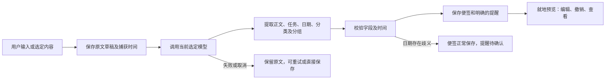

# 速记便签功能结构设计

设计日期：2026-11-18。状态：首版已实现，具体实现差异见下节。

## 实现说明

工具中心、主助手和桌面助手现已接入速记。支持手动记录、AI 整理和按事项拆分、分类与项目分组、卡片/列表/时间线、待办、工作留痕、原文及修订、批量归档删除、Markdown/JSON 导出、工作小结、一次及重复提醒、提前提醒、稍后提醒和备份恢复。

实现沿用下文的业务边界，并做以下存储与交互调整：

- 分类和分组合用 `quick_note_folders`，通过 kind 区分；待办保存在便签的经过校验的 JSON 中，与便签修订一同提交，未另建任务表。
- 实际业务表为 `quick_notes`、`quick_note_folders`、`quick_note_captures`、`quick_note_revisions`、`quick_note_reminders`、`quick_note_reminder_events`。前五张进入现有业务备份，通知投递事件留在本机。
- 重复提醒首版按本机日历时区计算；保存 UTC 触发点及来源时区。尚不提供与系统时区不同的独立 IANA 时区选择。
- 工作小结生成后保存成可编辑的新便签，原工作记录不被覆盖。AI 补分类只填收件箱/未分类和空标签，不改人工内容、任务及提醒。
- 主助手与桌面输入框在模型选择器左侧提供“速记”模式开关，选中仅使用颜色和背景区分。开启后 Enter/发送记录便签，关闭后恢复普通对话。工具工作区保留速记范围选择。
- 桌面速记复用桌宠的思考动作和回复气泡，可停止整理、查看便签；关闭输入框不取消后台整理。未启用桌宠时，结果进入输入框已有的回复区域。
- AI 整理先读取现有分类、项目分组与别名，严格区分目录类型，优先复用，内容明确且没有合适目录时可自动新建。目录和便签在同一事务内提交，失败一起回滚。助手也可通过 `quick-notes:folders` 和 `quick-notes:organize` 静默读取、整理和创建目录。
- AI 整理会纠正错别字和病句、保留原意；结果校验失败时，将原文、上次输出和具体错误交回同一模型，最多修正两次。网络错误、取消和人工修改冲突不重试；每次失败回滚便签及新目录，原文继续保留。
- “日历日程”提供公历月视图、农历日期、年月切换、回到今天和当日事项。便签按事项日期（未填写时按创建日期）、待办按截止日期、提醒按下一次触发日期显示；支持按日期筛选、打开已有编辑器和按所选日期新建便签。日历仅展示已加载记录，分页时可继续加载。
- Windows 系统通知点击可定位原便签；完整的完成、已读和稍后提醒操作放在提醒中心。没有安装的开发程序沿用系统通知标识，正式安装包使用应用标识。
- 系统提醒需要应用运行或驻留托盘，完全退出后下次启动补发；没有创建独立系统服务。

验证入口：`node scripts/test-quick-notes.mjs` 执行隔离浏览器交互与截图；Rust 的 `quick_notes_store::tests` 和 `quick_notes::tests` 验证存储、提醒、备份恢复及 Chat/Responses/Claude 模型调用。

浏览器回归包含农历、日期归属、区间筛选、新建与编辑、月末、闰年及跨年切换；设置 `NOTES_TEST_ARTIFACT_DIR` 可将截图和页面结果输出到独立目录。

本文覆盖工具入口、手动记录、大模型整理、助手一键速记、便签与待办、定时提醒、工作留痕、自动分类及分组显示。下文的默认行为是本轮建议方案，可作为后续实现和验收依据。

## 1. 模块定位与功能结构

在工具中心增加“速记便签”，工具标识建议为 `quick-notes`。记录统一保存在本机，工具页、主助手和桌面助手使用同一份数据。

```text
速记便签
├─ 快速记录
│  ├─ 手动输入、粘贴文本、直接保存
│  ├─ AI 整理：标题、正文、分类、项目分组、标签
│  ├─ 提取待办、日期、提醒和工作留痕
│  └─ 保留原文、整理结果、来源及生成状态
├─ 记录管理
│  ├─ 普通便签 / 待办 / 工作留痕
│  ├─ 分类、项目分组、标签、颜色、置顶
│  ├─ 卡片 / 列表 / 工作时间线
│  └─ 查询、筛选、批量移动、归档、回收站
├─ 待办管理
│  ├─ 多项任务、优先级、截止日期、备注
│  ├─ 待完成 / 进行中 / 已完成 / 已取消
│  └─ 完成时间、重新打开、关联原便签
├─ 提醒管理
│  ├─ 指定时间、提前提醒、重复提醒
│  ├─ 稍后提醒、暂停、关闭、已读
│  ├─ 托盘运行时提醒、唤醒与重启补发
│  └─ 提醒记录、失败状态、点击定位原记录
├─ 工作留痕
│  ├─ 工作日期、项目、事项、过程、结果
│  ├─ 问题与阻塞、后续待办、关联资料
│  ├─ 来源快照、修改记录、完成记录
│  └─ 按项目和日期回看，生成工作小结并导出
└─ 助手联动
   ├─ 模型选择器旁的“速记”按钮
   ├─ 输入内容、选定消息、最近一轮对话转速记
   ├─ 通过内部接口静默保存和查询
   └─ 保存结果就地反馈，按需查看和编辑
```

三种记录类型分别解决不同问题，但共享编辑、分类、分组、搜索和提醒能力。一条工作留痕或普通便签可以包含多个待办，不必复制为多条记录。

## 2. 记录类型、分类、分组和标签

这些维度相互独立，避免“工作留痕”“AI-Manager”“401”混在同一层目录。

| 维度     | 用途                       | 示例                                                                 | 规则                           |
| -------- | -------------------------- | -------------------------------------------------------------------- | ------------------------------ |
| 记录类型 | 决定主要字段和展示方式     | 普通便签、待办、工作留痕                                             | 每条一个主类型，允许转换       |
| 分类     | 说明事情属于哪类活动       | 需求计划、开发实现、问题排查、会议沟通、发布部署、学习资料、生活事务 | 每条一个主分类，可手动调整     |
| 分组     | 归属项目、客户或自定义集合 | AI-Manager、某客户项目、个人事项                                     | 每条归属一个分组，默认“收件箱” |
| 标签     | 补充关键词，跨分类筛选     | 服务商、认证、401、版本发布                                          | 每条可以有多个标签             |
| 状态     | 描述记录或任务当前情况     | 活跃、归档；任务待完成、进行中、已完成                               | 记录生命周期与任务状态分别维护 |

AI 根据内容自动判断类型、分类、分组和标签。优先匹配已有目录及用户维护的分组关键词、别名，例如“反代、桌宠、Provider”可以关联 AI-Manager。

自动归类规则：

1. 用户已选择或手动修改的字段优先，后续 AI 整理只补空项。
2. 内容明确、能匹配已有目录时直接归类并保存。
3. 无法确定时进入“收件箱 / 未分类”，仍正常保存，展示待整理标记。
4. 没有匹配分组时可给出建议名称，默认不由模型自行创建大量新目录。
5. 用户可选择记录或一批记录重新分类；重新分类不改变记录时间、完成状态和提醒设置。
6. 合并、重命名分类或分组时同步调整引用；移除目录时将记录移至默认目录。

首版采用平级分组，支持新建、重命名、排序、合并和归档。分组归档影响导航展示，原记录和已启用提醒继续按各自状态运行。

## 3. 工具页面和显示方式

页面建议采用“左侧导航 + 主工作区 + 按需打开的详情面板”。

| 区域         | 内容                                                                     |
| ------------ | ------------------------------------------------------------------------ |
| 左侧快捷视图 | 全部记录、收件箱、待办、今日提醒、已逾期、工作留痕、已完成、归档、回收站 |
| 左侧分组     | 自定义项目分组及数量，支持搜索与切换                                     |
| 顶部操作     | 搜索、新建、AI 速记、分类与分组管理、导出                                |
| 筛选区       | 记录类型、分类、标签、任务状态、日期范围、提醒状态                       |
| 主工作区     | 便签卡片、紧凑列表、工作时间线；切换后保留筛选条件                       |
| 详情面板     | 正文、任务、提醒、工作字段、来源原文、修改历史                           |

“分组显示”提供独立选择器：按项目分组、按分类、按日期、按任务状态、不分组。展开与折叠、当前视图、筛选和排序可记忆。

默认展示便签卡片，置顶记录在前，其余按最近修改排序。临近提醒和已逾期事项有明确标记，切换到“今日提醒”时按提醒时间排序。

卡片展示：标题、正文摘要、分类与分组、标签、任务完成数量、最近一次提醒时间、事项日期及记录时间。待办卡片显示勾选框，工作留痕卡片突出项目、工作日期和当前结果。

用户操作包括编辑、置顶、改色、移动分组、修改分类、完成任务、设置提醒、复制、归档和删除。删除进入回收站，可恢复；彻底删除由用户主动执行。

## 4. 手动记录与 AI 速记

### 4.1 手动输入

点击“新建”后，可输入标题和正文，选择记录类型，添加任务、日期和提醒，直接保存。标题可留空，系统从正文首行截取一个可编辑标题。

手动保存、任务管理和提醒不依赖模型。可选择“AI 整理并保存”，也可先保存原文，再对已有记录执行整理或补分类。

### 4.2 AI 整理流程



默认一份输入整理成一条便签，允许包含多项任务。涉及多个独立事项时提供“按事项拆分”，拆分后的记录保留同一批次来源，可分别归类。

点击“AI 整理并保存”即授权整理和保存，不在正常流程中增加一次通用确认。保存后可立即编辑或撤销。日期不明确、新分组建议等只针对相应字段提示，不阻塞原文保存。

模型输出包括标题、整理正文、类型、分类和分组建议、标签、任务、日期表达、提醒候选、工作留痕字段及待确认项。后端校验后才写入正式记录，非法字段不直接进入数据库。

模型调用规则：

- 从助手入口发起时，使用点击时助手选中的模型，保存调用时的模型快照。
- 工具页默认“跟随助手模型”，也可以指定速记模型；不改变助手原有设置。
- 支持已安装的本地助手模型和已配置的服务商模型；本地模型失败时保留原文，提供重试和手动保存。
- 已有便签再次整理时展示修改结果，保留用户已编辑字段及修订记录。
- 记录中的内容作为待整理资料，不会被当作控制软件或执行命令的指令。

## 5. 助手模型旁的“速记”按钮

主助手和桌面助手的模型选择器旁均增加“速记”。按钮执行整理与保存，不切换聊天发送模式。

默认内容选择规则：

| 条件                             | 速记范围                                           |
| -------------------------------- | -------------------------------------------------- |
| 用户明确选中了某段文字或某条消息 | 仅整理明确选中的内容                               |
| 没有明确选择，输入框有文字       | 整理当前输入，成功后清理未被用户继续修改的那份输入 |
| 输入框为空，已有完整回复         | 整理最近一轮完整的用户消息和助手回复               |
| 没有可整理内容                   | 打开新建便签编辑框                                 |

按钮附带范围选择：当前输入、最近一轮、选择消息、当前会话。默认不抓取其他会话。桌面助手使用当前输入或当前完整回复；更多历史范围通过主助手选择。

保存流程和反馈：

1. 点击时固定内容、模型、当前时间和来源消息 ID，之后继续输入或切换模型不会改变本次内容。
2. 已捕获的内容先落地为草稿；整理任务由后台持有，收起窗口后继续处理。
3. 成功后显示“已保存到 AI-Manager / 问题排查，含 1 项待办、1 个提醒”。
4. 同处提供“查看”“编辑”“撤销”，默认不跳转、不弹出主窗口、不抢焦点。
5. 正在生成的回复不作为完整一轮保存；可以等待完成，或手动选定已有文字记录。
6. 重复点击同一次生成操作使用同一请求标识，避免产生重复便签和提醒；用户主动再次记录相同文本仍被允许。

用户在聊天中明确说“记下来”“加入待办”“明天下午提醒我”时，助手也可以通过速记内部接口直接保存，并回读保存后的实际数据反馈结果。

## 6. 日期、时间和待办

### 6.1 各种日期的含义

| 字段                       | 含义                       | 生成规则                 |
| -------------------------- | -------------------------- | ------------------------ |
| 记录时间 `createdAt`       | 这份内容何时首次被捕获     | 后端生成，不由模型改写   |
| 更新时间 `updatedAt`       | 正文或业务字段最近修改时间 | 后端生成                 |
| 事项日期 `occurredOn`      | 事情发生或工作所属日期     | 用户填写，或从原文提取   |
| 截止时间 `dueAt / dueDate` | 某项任务要求何时完成       | 允许只有日期，也允许为空 |
| 提醒时间 `remindAt`        | 系统何时主动通知           | 独立于事项日期和截止时间 |
| 完成时间 `completedAt`     | 用户何时确认任务完成       | 实际完成操作时记录       |

记录时间与事项日期分开，例如今天补记上周工作：事项日期为上周，首次记录时间仍为今天。

所有绝对时间存为 UTC 时间点，并保留原时区和原始日期表达。初始时区跟随应用设置，当前环境为 `Asia/Shanghai`。日期型数据保存为当地日期，不强制转换成午夜时间。

### 6.2 日期解析与校验

- “今天、明天、下周一、两小时后”以点击记录时捕获的时间和时区为基准，不能以模型返回时间重新计算。
- “明天下午三点”可以确定具体时间；“明天三点”缺少上下文时提示确认上午或下午。
- “月底处理”可以标注截止日期，只有用户明确启用提醒才生成通知计划。
- 提到一个日期，不等于要求设置提醒。只有“提醒我”等明确意图或用户手动开启提醒才启用计划。
- “下周找时间”“有空再做”保存为任务备注和待确认时间，不猜测一个精确提醒点。
- 原文没有日期时留空，不以记录时间替代任务截止时间。

### 6.3 待办行为

每项待办包含内容、状态、优先级、截止日期或时间、提醒、备注和完成时间。可以在卡片、列表或详情中完成、取消、重新打开；修改状态记录在历史里。

一条便签有多个任务时，各任务可以分别设置提醒和截止时间。全部任务完成后显示整体完成标记，便签正文和来源继续保留。重新打开任务时，过期提醒需要重新指定时间，避免立即重复触发。

## 7. 定时提醒

### 7.1 提醒设置

普通便签、工作留痕和单项待办均可设置提醒。

| 设置项     | 首版能力                                                       |
| ---------- | -------------------------------------------------------------- |
| 指定时间   | 选择日期和时分；快捷选择 10 分钟后、1 小时后、明天指定时间     |
| 提前提醒   | 根据任务截止时间提前 5、15、30 分钟、1 小时、1 天，或自定义    |
| 重复       | 每天、工作日、每周指定星期、每月指定日期；可设置结束日期或次数 |
| 多次提醒   | 一件事可安排提前提醒与到点提醒，使用不同计划                   |
| 稍后提醒   | 当前一次通知延后 5、10、30 分钟、1 小时，或选新时间            |
| 暂停和关闭 | 保留规则及记录，可恢复；关闭不删除便签                         |
| 提醒方式   | 系统通知及应用内提醒中心；声音可选                             |

月度提醒遇到不存在的日期时默认取当月最后一天，保存时明确展示该规则。重复提醒按照规则所属时区计算日历时间，不使用固定“24 小时”代替所有自然日。

调整截止时间时，按“截止前 15 分钟”等相对规则计算的提醒同步移动；独立指定时间的提醒保持原时间。界面展示移动后的具体时间。

### 7.2 到点行为

到点后产生一次提醒记录并发送系统通知，应用内提醒中心显示未读数量。通知内容包括标题、关键事项、所属项目，以及原定提醒时间。

点击通知打开对应便签。应用内提醒支持查看、稍后提醒、标记已读；关联待办还支持标记完成。通知出现本身不拉起主窗口或抢焦点。系统通知的交互按钮按平台支持程度提供，应用内提醒中心提供完整操作。

一次性待办完成、取消或删除后停止其后续提醒；普通便签的独立提醒不因某个子任务完成而被误关。归档会暂停所属提醒，恢复归档时由用户选择是否恢复未来计划；删除进入回收站时取消待发送提醒，恢复时不会立刻补发删除期间的计划。

周期待办完成本期后生成下一期，记录每期结果；选择“停止重复”才结束整个系列。普通重复便签提醒可独立暂停和停止。

### 7.3 应用运行与异常场景

| 场景                         | 行为                                                     |
| ---------------------------- | -------------------------------------------------------- |
| 主窗口关闭、应用仍在托盘运行 | 后台照常提醒                                             |
| 工具页面或助手窗口关闭       | 不影响提醒计划                                           |
| 电脑休眠后唤醒               | 检查已到点但尚未处理的提醒，补发并标注原定时间           |
| 应用重启                     | 从数据库恢复计划和待处理通知，不依赖前端计时器           |
| 完全退出应用                 | 默认无后台进程，不能承诺到点通知；下次启动补发未处理提醒 |
| 重复提醒错过多期             | 合并为一条错过提醒摘要，定位最近一期，不连续刷屏         |
| 系统通知权限关闭或系统勿扰   | 提醒中心保留记录，设置页显示通知状态；不假装通知已被看到 |
| 本机修改时间或时区           | 重新校验最近触发点，已完成的一次提醒不重复创建           |
| 数据恢复到另一设备           | 记录和规则恢复，提醒默认暂停，避免多台设备重复通知       |

设置页应明确“提醒需要应用运行，可关闭主窗口并保留托盘”。如果后续要求完全退出仍到点提醒，再增加 Windows 系统任务或独立后台服务；该能力有独立安装、卸载和恢复机制。

提醒调度由后端服务负责，每次发生有独立标识，更新规则会取消旧的未触发计划。保存、稍后提醒、通知回调都执行幂等校验。对于进程恰好在系统通知投递后退出的情况，使用同一次通知标识进行去重或替换，并以提醒中心中的持久化记录为准。

## 8. 工作留痕

工作留痕通过手动录入或 AI 根据内容判断生成，不需要强制套完整表单；缺失字段允许为空。

| 信息       | 内容                                                   |
| ---------- | ------------------------------------------------------ |
| 归属       | 项目分组、分类、标签                                   |
| 日期       | 工作所属日期、实际记录时间、修改时间                   |
| 工作事项   | 做了什么，要解决什么问题                               |
| 处理过程   | 排查、讨论、实现、验证等明确发生的过程                 |
| 结果       | 已完成的结果、当前进展；没有说明时保持“未记录”         |
| 问题与阻塞 | 尚未解决的问题、等待事项                               |
| 后续任务   | 从工作内容提取可执行待办，关联截止日期和提醒           |
| 依据       | 原文、会话或消息来源、用户补充的链接及关联记录         |
| 变更历史   | 修改内容、修改时间、用户编辑或 AI 整理、任务完成或重开 |

AI 可以判断“今天修好了登录问题，明天回归测试”为工作留痕并生成后续待办；不能把“准备修复”“还没定位”写成已完成，也不能补造提交、发布、测试通过或验收结果。

工作时间线按事项日期展示，同一天按实际记录时间排列。允许跨天补记、关联先前事项、追加进展；追加保留原记录和变更历史。

“生成工作小结”支持按项目、分类、日期范围选择记录，生成今日、周或自定义范围的小结。内容包含完成事项、进行中、问题与阻塞、下一步计划，并保留来源记录链接。小结先作为可编辑结果展示，用户保存后成为一条新记录，不覆盖原始留痕。

## 9. 一次完整使用示例

输入：

> 今天修复了 AI-Manager 切换服务商后出现 401 的问题，明天下午三点提醒我做一次完整回归，重点检查 Claude 和 Codex。

假设在 2026-11-18 点击速记，结果如下。

| 字段     | 整理结果                                                 |
| -------- | -------------------------------------------------------- |
| 标题     | 修复服务商切换后的 401 问题                              |
| 类型     | 工作留痕                                                 |
| 分组     | AI-Manager                                               |
| 分类     | 问题排查                                                 |
| 标签     | 服务商、认证、Claude、Codex                              |
| 工作日期 | 2026-11-18                                               |
| 记录时间 | 实际点击记录的系统时间                                   |
| 结果     | 根据用户记录，已修复切换服务商后的 401；回归结果尚未记录 |
| 待办     | 完成 Claude 和 Codex 的完整回归                          |
| 提醒     | 2026-11-19 15:00，Asia/Shanghai                          |

工具中可按 AI-Manager 分组查看，也可切到“问题排查”分类或工作时间线。完成回归时勾选待办并补充结果，自动记录完成时间，停止本次待办后续提醒。

## 10. 数据结构建议

记录存入现有用户数据根目录下的 `workspace/storage/ai-manager.db`。原文、分类规则和提醒均持久化，不存到 Codex 配置目录，也不依赖窗口缓存。

| 表                           | 职责                     | 主要字段                                                                                                                                      |
| ---------------------------- | ------------------------ | --------------------------------------------------------------------------------------------------------------------------------------------- |
| `quick_notes`                | 便签及当前业务内容       | id、type、title、content、groupId、categoryId、tags、color、pinned、occurredOn、worklog、lifecycle、revision、createdAt、updatedAt、deletedAt |
| `quick_note_tasks`           | 便签内待办               | id、noteId、title、status、priority、dueDate、dueAt、timeZone、completedAt、sortOrder、revision                                               |
| `quick_note_groups`          | 项目分组                 | id、name、aliases、description、sortOrder、archivedAt                                                                                         |
| `quick_note_categories`      | 活动分类                 | id、name、aliases、description、sortOrder、archivedAt                                                                                         |
| `quick_note_captures`        | 原文和来源快照、整理进度 | id、requestId、batchId、noteId、sourceType、threadId、messageIds、sourceText、capturedAt、timeZone、model、status、error                      |
| `quick_note_revisions`       | 编辑和状态变更历史       | id、noteId、operation、before、after、createdAt、actor、captureId                                                                             |
| `quick_note_reminders`       | 提醒规则                 | id、noteId、taskId、schedule、timeZone、nextFireAt、endAt、enabled、revision                                                                  |
| `quick_note_reminder_events` | 每次提醒与通知处理结果   | id、reminderId、scheduledAt、snoozedUntil、deliveryState、sentAt、readAt、action、error                                                       |

标签和工作字段首版可使用经过校验的 JSON，减少无用关系表。提醒事件、任务和历史需要独立记录，支持查询、恢复及去重。

关键约束：

- 同一 `requestId` 只创建一次捕获任务；内容相同但请求不同，允许用户主动再次记录。
- 每项任务归属明确的便签，任务提醒必须归属于同一便签。
- 同一提醒规则、同一计划时间只产生一个提醒事件。
- 修改使用 revision 校验，多个窗口同时编辑时提示冲突，不静默覆盖。
- 保存便签、待办及提醒在事务中完成；失败不能留下孤立任务或无主提醒。
- 来源快照保留首次原文；修改正文及重新整理追加修订记录，不覆盖最初的记录时间。
- AI 草稿、失败任务和正式便签有明确状态；失败原文可以恢复，不混成已完成速记。

备份纳入便签、任务、分类、分组、来源、修订和提醒规则。后台任务锁、设备通知投递状态属于本机运行数据。恢复同一条记录按 ID 和 revision 处理，避免重复导入；不把恢复行为当作一次新提醒。

## 11. 与现有工程的集成

### 11.1 已确认可复用的能力

| 现有位置                                                     | 复用方式                                                       |
| ------------------------------------------------------------ | -------------------------------------------------------------- |
| `src/features/tools/constant.js`                             | 增加统一工具入口，同步供工具中心与悬浮工具使用                 |
| `src/features/tools/index.vue`                               | 按现有工具页模式按需载入速记页面                               |
| `src/features/assistant/index.vue`                           | 在主助手模型选择器旁接入速记按钮及范围选择                     |
| `src/features/assistant/components/DesktopInput.vue`         | 在桌面助手增加相同入口                                         |
| `src/features/assistant/components/AssistantModelSelect.vue` | 沿用模型选择能力，按钮由调用页面添加，避免改变公共组件默认行为 |
| `BaseModal`、`MarkdownContent`、现有格式化及请求工具         | 编辑、预览和业务请求共用原有组件与工具                         |
| `src-tauri/src/core/database.rs`、`paths.rs`                 | 使用现有数据库路径、事务及用户数据根目录                       |
| `src-tauri/src/api/proxy.rs` 及 `local_models`               | 复用模型目标解析和本地模型运行能力                             |
| `src-tauri/src/api/assistant/tools/app_api.rs`               | 助手通过业务接口操作速记，静默执行和回读                       |
| `src-tauri/node/assistant-tools/app-api.json`                | 注册可供助手查询和调用的速记接口                               |
| 已注册的 `tauri-plugin-notification`                         | 发送系统通知，后端提醒调度另补业务逻辑                         |

速记整理应有独立后台任务，不占用或取消现有聊天任务；共享模型连接和协议适配，不把速记内容伪装成普通聊天发送，也不写入助手公共记忆。

### 11.2 建议新增模块

```text
src/features/quick-notes/
├─ index.vue                       工具工作区
├─ components/QuickNoteCard.vue    重复使用的便签展示
├─ components/QuickNoteEditor.vue  新建、编辑、来源和提醒编辑
└─ components/QuickNoteCapture.vue 助手与工具共用的速记预览及状态

src/api/modules/quick-notes.js     前端业务接口
src-tauri/src/api/quick_notes.rs   业务请求、AI 整理与任务状态
src-tauri/src/api/quick_notes/reminders.rs
                                  后台调度及系统通知
src-tauri/src/core/quick_notes_store.rs
                                  存储、迁移、查询和事务
```

速记是同时被工具中心和助手调用的业务模块，因此放在独立 feature 下；内部组件围绕这一个业务复用，不扩展为无明确使用方的通用便签框架。

### 11.3 业务接口建议

| 接口组                                                 | 行为                                       |
| ------------------------------------------------------ | ------------------------------------------ |
| `quick-notes:list / detail`                            | 搜索、筛选、分页、读取详情和来源           |
| `quick-notes:save`                                     | 手动创建或编辑，传 revision 防止覆盖       |
| `quick-notes:capture / capture-state / capture-cancel` | 提交速记、读取整理进度、取消整理并保留原文 |
| `quick-notes:task-update`                              | 完成、重开、取消及修改单项任务             |
| `quick-notes:classify`                                 | 指定记录重新分类，保留人工锁定字段         |
| `quick-notes:organize`                                 | 分类、分组的新建、修改、合并与排序         |
| `quick-notes:reminder-save / reminder-pause`           | 创建、更新、暂停提醒规则                   |
| `quick-notes:reminder-events / reminder-action`        | 查看提醒、标记已读、稍后提醒、完成关联任务 |
| `quick-notes:archive / trash / restore`                | 生命周期管理和恢复                         |
| `quick-notes:summary / export`                         | 生成工作小结、导出 Markdown 或 JSON        |

主窗口、桌面助手和工具窗口监听模块自己的数据变化事件，不刷新整个应用状态。保存接口返回记录 ID、实际分类与分组、任务数量、已启用及待确认提醒，助手据此反馈。

## 12. 首版交付范围与验收

建议按以下顺序实现，每一步沿用相同的数据模型，最终首版包含用户本轮提出的全部核心能力。

| 顺序 | 交付内容                                                       |
| ---- | -------------------------------------------------------------- |
| 1    | 便签存储、手动录入、类型、分类分组、卡片和列表、搜索、任务状态 |
| 2    | AI 整理、自动归类、来源与修订、主助手及桌面助手一键速记        |
| 3    | 一次及重复提醒、系统通知、提醒中心、稍后提醒、重启和唤醒恢复   |
| 4    | 工作留痕字段及时间线、按项目和日期汇总、导出、备份恢复         |

首版验收标准：

1. 手动记录无需模型，保存后重启可见，记录时间准确且不随编辑变化。
2. AI 能从混合正文提取待办、日期、项目和分类；未明确的字段保留空值或待确认状态。
3. 本地模型调用使用已选本地模型，整理失败原文仍保留。
4. 两个助手入口均可一键保存，默认不打开工具页、不抢焦点、不清除用户后来输入的内容。
5. 同一保存请求重试不产生重复便签、任务或提醒。
6. 可按分组、分类、日期和任务状态显示，同一份记录在视图切换后保持一致。
7. 工作留痕保留原文、工作日期、创建时间、修改历史及后续任务，不补造工作结果。
8. “明天下午三点”按捕获时区准确生成提醒；模糊日期不会直接创建错误通知。
9. 托盘运行可提醒，重启或唤醒能恢复待处理提醒；完全退出的行为在设置中明确说明。
10. 待办完成或取消后，相应提醒停止；周期任务和便签级提醒按各自规则处理。
11. 同一提醒不会因多窗口同时打开重复调度；通知未送达与用户未读分别展示。
12. 已有记录重新整理、改分类或移动分组，不会改掉人工确认的日期和提醒。
13. 删除可恢复，归档和恢复时提醒行为符合本设计；彻底删除不会留下仍在触发的计划。
14. 恢复业务备份不会覆盖本机投递状态或立即产生一批跨设备重复提醒。
15. 工作小结可以定位到来源记录，重新生成不会覆盖原始工作留痕。
